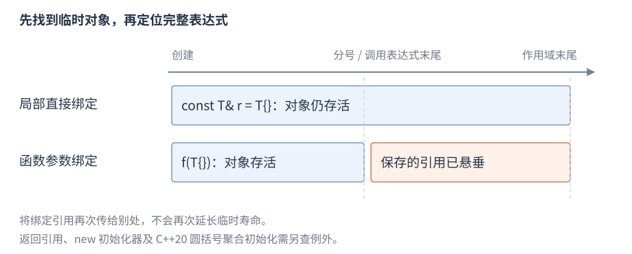

# 指针与引用

**指针**（pointer）保存指向对象或函数的位置，**引用**（reference）为对象或函数提供别名。本节先给声明、访问和传参，再解释数组区间、临时对象与借用寿命。

适用范围：C++17。阅读前需要[整数初始化](R03-initialization-deduction.zh-CN.md#初始化类别)、[常用表达式](R04-expressions-conversions.zh-CN.md)和[条件、循环与普通函数](R06-statements-functions.zh-CN.md)。基本引用只需要分清已有对象和计算结果；完整值类别在[拷贝与移动](R08-copy-move.zh-CN.md#值类别)中继续展开。所有权由[RAII 与内存管理库](R09-raii-memory.zh-CN.md)维护。

## 指针声明、取址与解引用

`T* p` 声明指向 `T` 的指针，`&object` 取地址，`*p` 访问所指对象；对类指针 `p->member` 等价于适用的 `(*p).member`。

```cpp
int value = 7;
int* p = &value;
int observed = *p;             // 7
*p = 9;                       // value 为 9
int other = 3;
p = &other;                   // 改变指向，value 仍为 9
```

指针本身和所指对象是两个不同对象，改变指针不会复制或销毁原目标。声明 `int* p, q;` 中只有 p 是指针；分别声明可避免误读。非空指针仍须指向可访问的有效对象，正确类型、寿命、对齐和边界是访问条件。

## nullptr 与可选借用

`nullptr` 是专门的空指针常量，可以初始化适用指针，也可以与指针比较。用空指针表达没有可选对象：

```cpp
void increment_if_present(int* value) {
    if (value != nullptr) ++*value;
}
// 调用下面的两次操作时，count 先取初值 3
int count = 3;
increment_if_present(&count); // count 为 4
increment_if_present(nullptr); // 不修改任何对象
```

用 `nullptr` 避免整数 `0` 带来的重载歧义。普通自动局部指针 `int* p;` 没有确定初值，不能通过 `if (p)` 使它有效；声明时给适用地址或 `nullptr`。空指针不能解引用，也不能据其构造一个可用引用。

内建短路也可在表达式中保护访问。下面的 `p` 初始为空，因此不会读取右侧的 `*p`：

```cpp
int value = 4;
int* p = nullptr;
bool positive = p && *p > 0;   // false，不解引用
p = &value;
bool present = p && *p > 0;    // true
```

## 左值引用与右值引用

**`T&`** 声明左值引用，通常绑定标识已有对象的左值；**`T&&`** 声明右值引用，通常绑定适用右值，整数常量 `42` 就能提供这样的初值。`const T&` 可只读绑定既有对象或适用临时。

```cpp
int value = 7;
int& alias = value;
alias = 9;                    // 修改 value，不重新绑定 alias
const int& read_only = value;
int&& temporary = 42;         // 绑定临时 int，局部寿命延长
int snapshot = temporary;     // temporary 名称表达式是左值，读取为 42
```

引用定义通常需要初值，绑定后不重新绑定；参数/返回类型声明、某些成员与 `extern` 声明允许省略初值。赋值给引用是修改被引用对象。引用没有用来表示缺对象的合法空状态；“必选借用”仍要求调用方提供活对象。右值引用的移动/转发用途见[拷贝与移动](R08-copy-move.zh-CN.md)。

| 声明形式 | 主要语义 | 初始化后的常见操作 |
| --- | --- | --- |
| `T*` | 可为空、可重新指向 | 解引用有效目标，或改变指向 |
| `const T*` | 通过此路径只读目标 | 可改变指针指向 |
| `T* const` | 指针本身固定 | 可修改适用的非 const 目标 |
| `T&` | 绑定对象、通常可修改 | 赋值修改目标，不能重新绑定 |
| `const T&` | 只读绑定 | 可绑定适用临时，不保证任意借用长寿 |
| `T&&` | 右值引用 | 名称是左值；消费需适用移动操作 |

## const 与多级指针

`const` 在 `*` 左侧限制目标，在右侧限制该指针；可同时限制两者。

```cpp
int value = 7, other = 9;
const int* view = &value;
view = &other;                // 合法，指针可改
int* const fixed = &value;
*fixed = 8;                   // 合法，目标可改
const int* const fixed_view = &value; // 指针和目标访问均受限
```

多级指针需逐层分析。`T**` 不能直接转换为 `const T**`，否则可以把 `const` 对象指针写回原本允许修改目标的指针槽；适用的限定转换需要更完整的逐层 `const` 条件。不要用 cast 绕过保护后写入。

例如 `int**` 能访问一个可写的 `int*` 指针槽；若允许它直接变成 `const int**`，就可以向槽内存入 `const int` 的地址，再通过原来的 `int*` 写入只读对象。增加中间层的 `const` 可阻止这条路径：

```cpp
int value = 7;
int* p = &value;
int** slot = &p;
// const int** rejected = slot; // 不允许这项限定转换
const int* const* protected_slot = slot; // 指针槽经此路径也只读
```

## 引用与指针参数

参数是调用时初始化的实体；按值提供独立对象，引用和指针通常提供借用。下面按值计算、通过引用修改或只读访问一个整数，定义放在命名空间作用域：

```cpp
int twice(int value) { return value * 2; } // 适合便宜值
void increment(int& value) { ++value; }    // 修改调用者
int read(const int& value) { return value; }
```

| 参数形式 | 输入关系 | 常见接口意图 |
| --- | --- | --- |
| `T` | 建立独立参数对象 | 便宜值或需要自己的副本 |
| `const T&` | 只读借用 | 避免复制，调用中需要对象有效 |
| `T&` | 可修改借用 | 直接改变调用者对象 |
| `T*` | 适用时可为空的借用 | 可选对象，需约定是否拥有及长度 |

需要保留一份资源时，可按值接收再移动到成员；`const` 引用的间接访问和别名仍可能有成本。返回值通常表达独立结果，C++17 适用的复制消除见[拷贝与移动](R08-copy-move.zh-CN.md)。返回引用或指针必须说明所有者及失效条件。

```cpp
int source = 3;
int copied = twice(source);   // 6，source 仍为 3
increment(source);            // source 为 4
int observed = read(source);  // 4，读取调用者对象
```

`const std::string&` 同样可借用一个字符串，在[std::string](R12-strings-views.zh-CN.md#stdstring)介绍其成员后可用 `text.size()` 查询长度，避免为了读取而复制整个字符串。

## 数组身份与指针转换

数组在许多表达式中转换为首元素指针，长度不会保存在这个指针里。数组引用可以保留整个数组类型，下面同时比较两种声明；`std::size_t` 来自 `<cstddef>`：

```cpp
int values[3] = {3, 5, 7};
int* first = values;          // 指向 values[0]
int (&whole)[3] = values;     // whole 为整个数组的别名
std::size_t length = sizeof(values) / sizeof(values[0]); // 3
whole[1] = 9;                // values 依次为 3、9、7
```

`sizeof`、取数组地址和绑定数组引用等场合保留数组身份。函数参数 `int a[3]` 调整为指针参数，不保证调用者传了三个元素。`sizeof(first) / sizeof(*first)` 只是指针与元素的大小比，不能查询数组长度。固定长度接口可在模板基础之后使用数组引用模板；运行时长度须明确传入长度或有效范围。有终止符的接口必须保证终止符在有效范围内。

完整[数组身份与结构化绑定程序](../examples/r02-types-objects.cpp)保留数组引用；结构化绑定规则见[通用工具](R17-utility-results.zh-CN.md#结构化绑定)。

## 数组区间与指针算术

数组的元素地址与尾后地址组成有效区间；尾后指针可形成和作终点，但不可解引用。

```cpp
int values[3] = {2, 4, 6};
int* first = values;
int* last = values + 3;
int total = 0;
for (int* p = first; p != last; ++p) total += *p; // 12
std::ptrdiff_t length = last - first;             // 3，需 <cstddef>
```

指针加减必须保持在同一数组及其尾后范围；相减要求来自同一数组，差值可由 `std::ptrdiff_t` 表示。单个非数组对象在这些规则中视作长度一的数组；碰巧相邻的变量不成为一个数组。指针仅携带地址，接口无法从任意两个地址自动证明它们组成有效区间。

C++20 `span` 可保存范围长度但仍借用底层对象；访问仍须满足寿命和边界。查找一个整数可用下面的半开区间接口，它要求输入来自同一有效数组、元素已经初始化，空区间不解引用：

```cpp
int* find_value(int* first, int* last, int wanted) {
    for (; first != last; ++first)
        if (*first == wanted) return first;
    return nullptr;
}
```

成功返回匹配元素的地址，失败返回空；调用者的数组存活和相应失效条件决定返回借用能用多久。

## 范围 for 的引用元素

形状是 `for (元素声明 : 范围) 循环体`。按值声明复制元素，引用声明访问既有元素；下面使用数组，无需头文件：

```cpp
int values[] = {1, 2, 3};
for (int& value : values) value *= 2; // 元素变为 2、4、6
int total = 0;
for (int value : values) total += value; // 12
```

常见泛型声明是 `auto`、`auto&`、`const auto&`、`auto&&`，根据是否复制/修改选择。循环体修改容器可能使遍历的迭代器或终点失效，见各容器条目。

C++17/20 范围表达式建立隐含绑定，不自动保活其中所有嵌套临时；从临时所有者的访问函数取得成员引用作为范围可能悬垂。先给所有者一个名字再迭代，可明确寿命。

## 临时对象与寿命延长

**临时对象**在表达式计算中建立，通常在所在完整表达式末尾销毁；适用的直接引用绑定可延长它的寿命。下面把临时整数直接绑定到局部只读引用：

```cpp
const int& kept = 42;
int observed = kept;         // 42，临时整数仍然存在
```

局部 `const T& r = T{};` 或 `T&& r = T{};` 的适用直接绑定可延长临时到该局部引用的生命周期结束。把另一个引用绑定到它不会继续延长寿命；通过返回引用的访问函数获得临时所有者的成员，也不自动保活所有者。



图：直接局部绑定的临时跨越分号；函数引用参数所绑定的临时只到调用所在完整表达式末尾。横轴是语义事件，不是耗时。

返回语句绑定返回引用的临时不因返回类型延长寿命，函数引用形参的临时只活到调用完整表达式结束。规定的直接成员访问等路径还可延长完整临时对象；[引用成员与临时对象寿命](R07-classes-lifetime.zh-CN.md#引用成员与临时对象寿命)在类成员之后维护聚合、构造初始化器和 C++20 圆括号初始化的条件。

## 返回借用与非拥有成员

**借用**（borrowing）通过指针、引用或视图访问由别处负责保活的对象，不转移所有权。下面把调用者传入的整数作为返回借用：

```cpp
int& same(int& value) { return value; }
// 在函数体中调用：
int source = 3;
int& result = same(source);
result = 9;                  // source 为 9
```

返回时 `source` 仍然存在，所以 `result` 可以使用；不能返回函数局部对象的地址或引用。接口要说明所有者、借用到何时、哪些修改使其失效以及是否允许空。地址仍有效和逻辑元素身份未变是两个问题，容器失效见[顺序容器](R13-sequence-containers.zh-CN.md)。返回类成员的借用以及复制指针/引用成员的关系见[非拥有成员](R07-classes-lifetime.zh-CN.md#返回借用与非拥有成员)。

## 返回共享静态对象的引用

按值 `counter()` 返回当前计数的副本；若需要允许调用者访问同一个静态整数，可以返回引用。下面的引用始终指向同一个静态存储期对象：

```cpp
int& shared_counter() {
    static int value = 0;
    return value;
}
// 函数体中：
int& count = shared_counter();
count = 3;
int observed = shared_counter(); // 3
```

初始化同步只保护首次初始化，后续通过引用修改仍要遵守并发同步要求；共享可写访问的具体条件见[静态初始化与局部 static](R06-statements-functions.zh-CN.md#静态初始化与局部-static)。

## 函数指针与无捕获 lambda

**函数指针**保存可调用的函数位置。`int (*twice)(int)` 声明接收一个 `int`、返回 `int` 的函数指针，括号把 `*twice` 与函数参数列表分开。下面用无捕获 lambda 提供函数：

```cpp
int (*twice)(int) = [](int n) { return n * 2; };
int doubled = twice(3);        // 6
```

无捕获 lambda 可按规则转换为相应函数指针；带捕获通常不能。函数本身不是对象，但函数指针是对象。C 回调接口若另有上下文指针，要同时管理状态对象寿命与注销协议，不能保存函数退出后仍会使用的局部闭包地址。

## const_cast

`const_cast<T*>(p)` 或相应引用形式用于调整 cv 限定，常见于历史接口适配。下面从指向只读接口的指针恢复一个原本可修改对象的访问，放在函数体内：

```cpp
int value = 7;                 // 原始对象可修改
const int* view = &value;
int* writable = const_cast<int*>(view);
*writable = 9;                 // 合法，value 为 9
const int fixed = 7;           // 原始对象本身为 const
const int* fixed_view = &fixed;
// *const_cast<int*>(fixed_view) = 9; // 未定义行为，不执行
```

去掉访问路径上的 `const` 不改变对象的实际性质。适配一个接受 `char*` 的旧函数之前，应确认它是否写入以及原对象是否可修改；声明表面上的 `const` 不提供这项证明。`volatile` 的调整同样不能消除相关访问要求，函数指针等还有适用范围限制。

## reinterpret_cast

`reinterpret_cast<T>(expression)` 用于标准允许的低层转换，例如把对象地址转换为字节访问指针。下面只查看已有对象的表示；需 `<cstddef>`，放在函数体内：

```cpp
unsigned value = 0x1234u;
const unsigned char* bytes = reinterpret_cast<const unsigned char*>(&value);
unsigned checksum = 0;
for (std::size_t i = 0; i < sizeof value; ++i) {
    checksum += bytes[i];      // 读取对象表示中的字节
}
```

允许通过 `char`、`unsigned char` 或 C++17 的 `std::byte` 访问对象表示，但字节顺序及可能的填充由实现决定。该例不把某组字节值写成可移植输出。向任意 `T*` 转换并不在该地址建立 `T` 对象；使用结果还要满足对象类型访问、对齐和生命周期要求。不能把字节缓冲强制转换后解引用当成通用反序列化。字节复制条件见[类型特征与字节复制](R10-templates-compile-time.zh-CN.md#类型特征与字节复制)，存储重用见[placement new](R09-raii-memory.zh-CN.md#placement-new-与存储重用)，文本解析由[文本处理](R18-text-numeric.zh-CN.md)维护。

## 组合应用：有符号加法检查

以下摘录在加法之前判断 `int` 结果是否可表示；失败时保持输出参数原值。需要 `<limits>`。

<!-- source: examples/r04-expressions-conversions.cpp -->
```cpp
bool checked_add(int a, int b, int& result) {
    const int hi = std::numeric_limits<int>::max();
    const int lo = std::numeric_limits<int>::min();
    if ((b > 0 && a > hi - b) || (b < 0 && a < lo - b)) {
        return false;
    }
    result = a + b;
    return true;
}
```

`b > 0` 时 `hi - b` 可表示，`b < 0` 时 `lo - b` 可表示；短路保证只执行适用的检查。调用时先给输出对象一个值；成功后它被改为结果，失败保留原值：

```cpp
int result = 0;
bool first = checked_add(20, 22, result); // true，result 为 42
bool second = checked_add(std::numeric_limits<int>::max(), 1, result);
// second 为 false，result 仍为 42
```

完整[加法检查程序](../examples/r04-expressions-conversions.cpp)以 `20 + 22` 得到 42，再拒绝最大 `int` 加 1，成功输出 `sum=42 overflow=rejected`。

## 类型访问与配套例子

类型访问规则约束可通过哪些类型访问对象。把 `float*` 转成 `int*` 并解引用，不能靠大小相同获得合法性；字节观察、`memcpy` 或满足条件的 C++20 `bit_cast` 有各自保证。[类型与对象](R02-types-objects.zh-CN.md#sizeofalignof-与对象表示)维护对象表示，[类型特征与字节复制](R10-templates-compile-time.zh-CN.md#类型特征与字节复制)维护复制条件，[RAII](R09-raii-memory.zh-CN.md#placement-new-与存储重用)维护存储重用，[数值与位工具](R33-numeric-random-bits.zh-CN.md)维护标准工具。

完整[借用查找与临时保活程序](../examples/r05-pointers-references.cpp)组合展示 `find_value` 修改调用者元素、失败空返回，以及 `Owner` 直接局部绑定的寿命延长。返回地址不会拥有数组；其有效性仍由数组寿命和元素失效条件决定。
