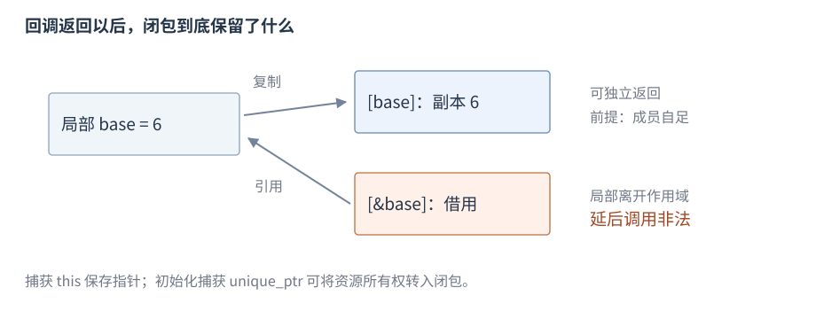

# 语句与函数

**函数**（function）以参数接收输入，并通过返回值或状态变化提供结果；**语句**（statement）控制执行、声明对象或计算表达式。本节先把已有整数计算写成按值函数，再介绍分支、循环和保存局部状态的 lambda。

适用范围：C++17。阅读前需要[整数初始化与按值 auto](R03-initialization-deduction.zh-CN.md)及[常用表达式](R04-expressions-conversions.zh-CN.md)。普通函数、条件和循环只使用整数、布尔值与数组；引用和可选指针参数在下一节[指针与引用](R05-pointers-references.zh-CN.md)加入。异常控制见[错误处理](R11-errors-exception-safety.zh-CN.md)。

## 函数声明、定义与调用

形状为 `返回类型 函数名(参数列表)`；声明以分号结束，定义提供函数体。函数可有零个或多个参数：

```cpp
int add(int left, int right);       // 声明
int add(int left, int right) {      // 定义
    return left + right;
}
// 函数体中调用：
int answer = add(20, 22);           // 42
```

调用前需要可见声明，参数接受对应实参，返回值用于初始化结果。声明中的参数名可省略，类型须一致；多个源文件共享声明的方式见[声明与定义](R01-program-build.zh-CN.md#声明与定义)。函数本身不是对象，但函数指针是对象。参数求值顺序见[求值顺序](R04-expressions-conversions.zh-CN.md#求值顺序与副作用)。

## 参数与返回值

**参数**在调用时由实参初始化，按值参数是独立对象；**返回值**把计算结果交给调用处。下面让函数修改自己的整数参数，再返回结果：

```cpp
int plus_two(int value) {
    value += 2;
    return value;
}
// 在函数体中调用：
int source = 3;
int result = plus_two(source); // 5，source 仍为 3
```

修改参数不会改变调用者的 `source`。返回值可初始化另一个对象；`void` 函数不交回值，可用 `return;` 提前结束。调用前需要可见的声明，实参必须满足参数类型与函数约定，例如普通有符号加法的结果必须可表示。想修改调用者对象时，再学习[引用与指针参数](R05-pointers-references.zh-CN.md#引用与指针参数)。

## 推导返回类型

函数可以从返回表达式推导返回类型。

```cpp
auto twice(int value) { return value * 2; } // 返回 int
```

多个未被丢弃的返回语句必须按规则得到相同类型，编译器不会额外寻找一个共同转换类型；使用这种返回类型前通常要看到相应定义。跨模块接口的显式返回类型更便于说明所有权和兼容性，泛型辅助函数可按需要推导。返回引用与借用条件见[指针与引用](R05-pointers-references.zh-CN.md)。

## 控制语句分类

复合语句 `{ ... }` 把多条语句组成一个块，也形成局部作用域。下面按控制任务分类；各对象在后续条目有常用语法和短例。

| 类别 | 语句 | 主要作用 |
| --- | --- | --- |
| 选择 | `if/else`、`switch` | 按条件或值选择分支 |
| 循环 | `for`、`while`、`do-while`、范围 for | 重复执行循环体 |
| 跳转 | `break`、`continue`、`return` | 退出循环/选择、进入下一轮、返回函数 |
| 编译期选择 | C++17 `if constexpr` | 在适用场景丢弃一个分支，见模板章 |

`goto` 和标签仅作为低频索引：它们执行显式跳转，但受不能跨越禁止的初始化等规则约束；本书基础路径不展开。嵌套块名字隐藏与对象寿命见[类型与对象](R02-types-objects.zh-CN.md#存储期对象生命周期与作用域)。

## if 与 else

语法形状是 `if (条件) 语句 else 语句`，`else` 可以省略。局部例子：

```cpp
int score = 75;
int level = 0;
if (score >= 90) {
    level = 2;
} else if (score >= 60) {
    level = 1;
} else {
    level = 0;
}
```

结果 `level` 为 1。条件进行布尔转换，只执行选中的分支。`else` 关联最近的未配对 `if`，使用花括号可明确嵌套结构。

C++17 中，初始化器的变量在条件及两分支中可见，`if` 结束后离开作用域：

```cpp
if (int value = 7; value > 0) {
    int doubled = value * 2; // 14，只在本块中可见
}
```

## switch

`switch (整数或枚举条件)` 在匹配 `case` 处开始执行，没有匹配时进入可选的 `default`。

```cpp
int command = 2, result = 0;
switch (command) {
case 1: result = 10; break;
case 2: result = 20; break;
default: result = -1; break;
}
```

结果 `result` 为 20。`case` 是适用的常量表达式标签，不能重复；没有 `break` 时可以贯穿到后续分支，刻意贯穿可用 C++17 `[[fallthrough]];` 表达。`case` 标签本身不形成块，分支有局部初始化声明时用花括号隔开，避免跨越初始化的非法跳转。

## for

形状是 `for (初始化; 条件; 迭代表达式) 循环体`：先初始化，再逐轮判断条件、执行循环体、执行迭代表达式。

```cpp
int total = 0;
for (int i = 1; i <= 3; ++i) {
    total += i;
}
```

结果为 6；这里 `i` 只在循环范围内可见。条件省略视作真，`for (;;) { ... }` 可表示持续循环，需要明确退出路径。

## while 与 do-while

`while (条件)` 先判断再执行；`do { ... } while (条件);` 先执行一次再判断。

```cpp
int remaining = 3;
while (remaining > 0) --remaining; // 最后为 0
int attempts = 0;
do {
    ++attempts;
} while (attempts < 1);            // 即使首次条件不成立也执行一次
```

两个循环都需要使退出条件有机会成立；`do-while` 末尾的分号是语法的一部分。

## 范围 for

形状是 `for (元素声明 : 范围) 循环体`。下面按值读取数组中的整数，每一轮初始化一个新的 `value`：

```cpp
int values[] = {1, 2, 3};
int total = 0;
for (int value : values) total += value; // 6
```

`value` 是该轮元素的副本，通过它修改值不修改原数组。要遍历并修改原元素，使用[范围 for 的引用元素](R05-pointers-references.zh-CN.md#范围-for-的引用元素)。容器循环还须遵守迭代器与终点失效规则，见各容器条目。

## break、continue 与 return

`break` 退出最近的循环或 `switch`；`continue` 进入最近循环的下一轮（`for` 会继续执行迭代表达式）；`return` 结束整个当前函数。

```cpp
int total = 0;
for (int i = 1; i <= 5; ++i) {
    if (i == 2) continue;
    if (i == 4) break;
    total += i;
} // total 为 4，只累加了 1 和 3
```

`return expression;` 形成返回结果，`void` 函数可用 `return;`。正常离开作用域销毁相应自动对象；返回引用不能指向已经销毁的局部对象。

## 默认实参与函数重载

默认实参在调用点补足省略的尾部参数，声明必须对调用者可见：

```cpp
int scale(int value, int factor = 2) { return value * factor; }
// 函数体中调用：
int a = scale(3);              // 6
int b = scale(3, 4);           // 12
```

默认实参不是函数类型的一部分，也不参与决定最佳重载。虚函数与重写的默认实参差异在[继承与多态](R07-classes-lifetime.zh-CN.md#虚函数override-与-final)之后说明。

函数重载使用相同名字及不同适用参数列表，不能仅以返回类型区分：

```cpp
int magnitude(int value) { return value < 0 ? -value : value; }
double magnitude(double value) { return value < 0 ? -value : value; }
// 函数体中调用：
int a = magnitude(-3);         // int 重载，3
double b = magnitude(-2.5);    // double 重载，2.5
```

本例整数输入不为最低值。重载决议收集候选、检查可行性和转换、选择最佳匹配；没有唯一最佳就产生歧义。默认参数可使一参和带默认值的两参重载同时可行，返回变量类型不能替调用选函数。模板/非模板也不能脱离转换质量概括为总优先某一类。

## 静态初始化与局部 static

这里的常量初始化使用满足常量求值条件的初值；零初始化对整数设置零值。静态存储期对象先进行**静态初始化**（常量初始化或零初始化），必要时再**动态初始化**。跨翻译单元动态初始化的排序具有复杂条件，不能把源文件排列当作依赖机制。

```cpp
int counter() {
    static int value = 0;
    return ++value;
}
```

第一次调用得到 1，再调用得到 2；`value` 的存储不会在函数返回时结束。函数内静态对象在首次控制经过声明时按规则初始化；C++11 起并发首次初始化有同步保证，之后对对象的业务访问仍需相应同步。初始化抛异常时下次经过会重试；递归重入正在初始化的声明具有未定义行为。依赖应由构造参数或明确入口表达，并考虑退出时的销毁顺序；类成员顺序由[构造与析构](R07-classes-lifetime.zh-CN.md)维护。

完整[初始化与推导组合程序](../examples/r03-initialization-deduction.cpp)包含 `vector` 构造差异与类型断言。

## lambda 表达式

**lambda 表达式**创建能保存捕获状态并被调用的**闭包**（closure）对象。像函数一样，在对象名后写 `(实参)` 就能调用它；闭包的匿名类与调用运算符机制在[函数对象](R07-classes-lifetime.zh-CN.md#函数对象)展开。常用形状是 `[捕获](参数) mutable -> 返回类型 { 函数体 }`，`mutable` 和返回类型可按需要省略。

```cpp
int base = 6;
auto add = [base](int value) { return base + value; };
int answer = add(4);           // 10
base = 100;
int still = add(4);            // 仍为 10，捕获的是原值副本
```

无捕获写 `[]`，返回类型通常按返回表达式推导。参数写 `auto` 的泛型 lambda（C++14 起）需要按调用类型实例化，见[泛型 lambda](R10-templates-compile-time.zh-CN.md#泛型-lambda)。

## lambda 捕获

**按值捕获**保存副本，**按引用捕获**借用原对象，初始化捕获可指定新的初值：

```cpp
int count = 0;
auto increment = [&count] { ++count; };
increment();                  // count 为 1
auto local = [count]() mutable { return ++count; };
int own = local();            // 2，外部 count 仍为 1
```

| 捕获形式 | 闭包保存的关系 | 延后调用的条件 |
| --- | --- | --- |
| `[x]` | x 的副本 | 副本中指针/引用仍可能借用外部 |
| `[&x]` | 对 x 的引用 | x 必须存活，跨线程访问需同步 |

按值闭包的调用运算符默认 `const`，`mutable` 允许改其副本；引用捕获允许修改借用目标。复制闭包分别复制其捕获成员；`mutable` 状态可产生独立计数器，但并发调用同一个闭包仍需同步。



图：整数副本可独立存活，引用捕获依赖原对象。语言不规定闭包中的物理布局。

引用捕获的 `&count` 表示继续访问同一个外部整数，因此外部对象必须存活；这里直接说明这项关系，不要求先掌握指针语法。初始化捕获可以写出自己的名字与初值：

```cpp
auto add = [base = 6](int value) { return base + value; };
int answer = add(4);           // 10，闭包持有自己的 base
```

类成员捕获见[lambda 的类成员捕获](R07-classes-lifetime.zh-CN.md#lambda-的类成员捕获)，移动资源的初始化捕获见[拥有资源的 lambda 捕获](R09-raii-memory.zh-CN.md#拥有资源的-lambda-捕获)。

## std::invoke

**`std::invoke`**（C++17，`<functional>`）统一调用适用的可调用对象并返回目标结果。这里用已经认识的 lambda：第一个参数是调用目标，后续参数传给它。

```cpp
auto add = [base = 6](int value) { return base + value; };
int answer = std::invoke(add, 4); // 10，与 add(4) 相同
```

调用是同步的，不延长捕获所借用对象的寿命，不吞掉目标异常。类成员也可通过成员指针调用，完整成员指针例与转发签名见[std::invoke 的成员指针与转发接口](R10-templates-compile-time.zh-CN.md#stdinvoke-的成员指针与转发接口)。

## std::function

**`std::function`**（`<functional>`）保存具有同一调用签名的可调用目标。`std::function<int(int)>` 中，括号前的 `int` 是返回类型，括号中的 `int` 是参数类型；无论保存哪个适用目标，调用者都通过这个签名调用。隐藏具体目标类型的机制称为**类型擦除**（type erasure），[完整模板声明](R10-templates-compile-time.zh-CN.md#stdfunction-的签名模板)在模板语法之后展开。

```cpp
std::function<int(int)> callback = [base = 6](int n) { return base + n; };
int answer = callback(4);      // 10
std::function<int(int)> empty;
bool present = static_cast<bool>(empty); // false
callback = nullptr;           // 清空目标
```

构造/赋值接收适用的可调用目标；复制包装器复制目标，目标在 C++17 必须可拷贝。`operator()` 调用目标，空包装器调用抛出 `std::bad_function_call`；`operator bool` 检查有无目标，`swap` 交换目标，赋值 `nullptr` 清空。可能发生分配，不能假定零成本。`target_type/target<T>` 用于低频目标查询，本书仅索引。

## 延后回调与配套例子

**回调**交由另一段逻辑在规定时机调用。保存方、调用次数和线程、取消是否确认以及异常接收方都是接口条件；取消后仍在途的调用不能访问已销毁的目标。

本节的按值整数捕获可随闭包保存；按引用捕获必须保证原对象在调用时仍然存在。涉及拥有资源的完整[值捕获与拥有资源闭包程序](../examples/r06-statements-functions.cpp)在[拥有资源的 lambda 捕获](R09-raii-memory.zh-CN.md#拥有资源的-lambda-捕获)中展开。跨线程和 C 回调边界具有额外异常/寿命约定，类型擦除不自动保存异常结果；任务关闭见[异步执行](R23-async-execution.zh-CN.md)，异常传播见[错误处理](R11-errors-exception-safety.zh-CN.md)。
