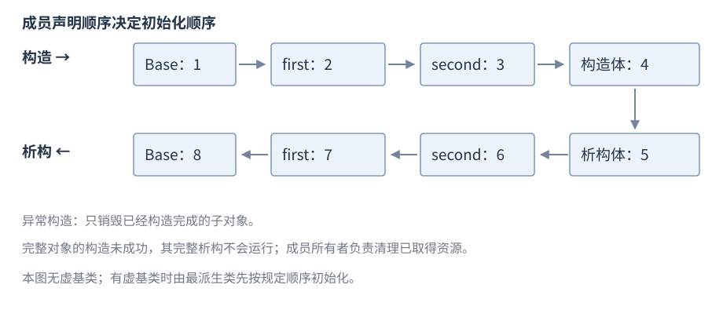
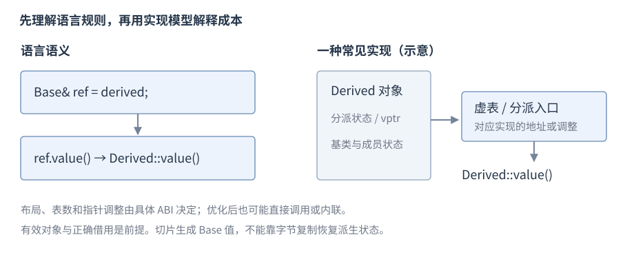

# 类与对象生命周期

**类**（class）把数据成员与操作成员组合为一个类型；**构造函数**建立对象状态，**析构函数**结束对象并释放所管理资源。先从一个对象保存的数据和可调用的操作开始，再看构造如何建立状态、析构如何结束对象。继承与多态在这些关系明确后展开。

**版本**：C++17。**先修**：[初始化](R03-initialization-deduction.zh-CN.md)、[引用](R05-pointers-references.zh-CN.md)、[函数](R06-statements-functions.zh-CN.md)。一般生命周期定义由[类型与对象](R02-types-objects.zh-CN.md)维护，资源所有权由[RAII](R09-raii-memory.zh-CN.md)维护。

## class、struct 与访问控制

类定义的形状是 `class Name { 成员声明 };`。**`class`** 默认成员和继承访问为 `private`，**`struct`** 默认为 `public`，其余能力相同。


```cpp
class Counter {
    int value_ = 0;           // 默认 private
public:
    void increment() { ++value_; }
    int value() const { return value_; }
};
// 使用片段
Counter counter;
counter.increment();
int count = counter.value(); // 1
```

例中 `counter` 是一个对象，`value_` 是它保存的数据，`increment()` 改变数据，`value()` 读取数据。`value()` 后的 `const` 表示这次读取不会通过当前对象修改普通数据成员；成员函数的完整规则稍后展开。

`public` 成员提供调用接口；`private` 成员由类成员及授权 `friend` 访问；`protected` 还支持适用的派生访问规则。简单记录可公开成员；有跨字段约束的类应通过成员函数维护**不变量**（invariant），即有效对象必须持续满足的状态条件。

## 构造函数与成员初始化

构造函数与类同名、无返回类型，成员初始化列表写在冒号后；初始化阶段先于函数体。


```cpp
class Count {
    int value_;
public:
    explicit Count(int value) : value_(value) {}
    int value() const { return value_; }
};
// 使用片段
Count count{7};               // value 为 7
```

`Count count{7}` 在建立 count 时调用构造函数：先用 7 初始化 `value_`，再进入构造函数体。初始化列表不是执行顺序表；普通成员按类内声明顺序初始化。

函数体内 `value_ = value;` 是成员已初始化后的赋值；引用和 `const` 成员通常必须在初始化阶段绑定或设值。默认成员初始化器在该构造没有另外初始化该成员时提供缺省值。`explicit` 阻止适用的隐式转换，不禁止直接构造。

委托构造把同类另一构造函数作为唯一初始化器：


```cpp
struct Point {
    int x, y;
    Point(int a, int b) : x(a), y(b) {}
    Point() : Point(0, 0) {}  // 先完成目标构造，再执行本构造体
};
```

委托初始化列表不能同时初始化其他成员。构造成功应建立完整可用状态，避免对象先发布到外部再补齐不变量。

## 析构函数

`~T()` 声明析构函数，无参数、无返回类型；它在对象销毁时执行清理，然后成员与基类继续按规则销毁。普通自动对象离开作用域时自动析构，拥有资源成员的析构实现资源释放。


```cpp
struct Record {
    int value;
    ~Record() = default;     // 请求默认析构规则
};
```

下面用一个计数观察普通作用域的进入与退出，类中保存的引用借用外部 count；此例只构造一个对象，不复制它：

```cpp
struct Active {
    int& count;
    explicit Active(int& value) : count(value) { ++count; }
    ~Active() { --count; }
};
int count = 0;
{
    Active active(count); // 构造后 count 为 1
}                         // active 析构后 count 为 0
```

count 比 active 活得久，所以析构时仍能安全访问它。自动调用析构让清理与对象寿命连接起来，下一节会用这一关系管理资源。

析构应保持必要释放且不向外传播异常；需要报告的 flush/commit 等业务结果放显式成员接口，见[错误处理](R11-errors-exception-safety.zh-CN.md)。在构造函数未完成时，不能指望该完整对象析构函数补救所有资源；应从取得资源起交给成员拥有者。

## 数据成员、成员函数与 const

非静态数据成员各对象各有一份；成员函数通过隐含 `this` 访问当前对象。静态成员属于类，调用不依赖某个对象。


```cpp
struct Meter {
    int value = 0;
    inline static int created = 0; // C++17 inline 变量
    Meter() { ++created; }
    int read() const { return value; }
    void set(int n) { value = n; }
};
```

`const` 成员函数可通过 `const` 对象调用，不能通过 `this` 修改普通非 `mutable` 成员；`mutable` 成员有相应例外。指针成员指向的外部对象不会因为成员函数 `const` 就成为 `const`，`const` 也不自动保证线程安全。类内定义的函数通常隐式 `inline`，跨文件定义规则见[ODR](R01-program-build.zh-CN.md#单一定义规则与多文件程序)。

## 类成员的大小与对齐

结构成员之间及末尾可以有填充，不保证成员大小之和等于结构大小。下面以一个字符和一个整数成员查询当前实现，需要 `<cstddef>`：

```cpp
struct Record { char tag; int value; };
std::size_t size = sizeof(Record);
std::size_t alignment = alignof(Record);
```

查询类型不需要先建立 `Record` 对象，结果由实现决定。对象表示与值表示的定义见[类型与对象](R02-types-objects.zh-CN.md#sizeofalignof-与对象表示)。

## 运算符重载与 friend

C++17 中，运算符重载用名为 `operator符号` 的函数为类或枚举定义操作。二元运算的成员形式是 `left.operator+(right)`，非成员形式是 `operator+(left, right)`；非成员可把左右操作数作为同等参数处理。`friend` 授予指定函数或类访问私有成员的权限；在类内定义的 `friend` 函数仍是非成员函数。

以下片段不需额外头文件，类定义放在命名空间作用域：

```cpp
class Distance {
    int metres_;
public:
    explicit Distance(int n) : metres_(n) {}
    int metres() const { return metres_; }
    Distance& operator+=(const Distance& other) {
        metres_ += other.metres_;
        return *this;
    }
    friend Distance operator+(Distance left, const Distance& right) {
        left += right;
        return left;
    }
    friend bool operator==(const Distance& a, const Distance& b) {
        return a.metres_ == b.metres_;
    }
};
// 函数体内；本例数值相加在 int 可表示范围内：
Distance a{3}, b{5};
Distance sum = a + b;       // sum.metres() 为 8，a 仍为 3
bool equal = (sum == Distance{8}); // true
```

| 接口选择 | 常见用途 | 注意条件 |
| --- | --- | --- |
| 成员函数 | 修改左侧对象，如 `+=` | 隐含对象是左侧操作数 |
| 非成员函数 | 对称的 `+`、`==` | 至少一个参数是类或枚举类型（或相应引用） |
| 非成员 friend | 需要访问私有表示 | 权限不使它成为成员，不随继承自动传播 |

C++17 中 `=`、`[]`、`()`、`->` 的重载必须是非静态成员。重载不能改变优先级、结合方式或操作数数量，也不能重载 `.`、`.*`、`::`、`?:`。C++17 的 `==` 不自动提供 `!=`；需要时另行定义。重载 `&&`、`||` 不提供内建逻辑运算的短路行为，详见[求值顺序](R04-expressions-conversions.zh-CN.md#求值顺序与副作用)。优先让符号保持读者熟悉的值语义；`friend` 访问授予应限制在所需接口。

## 函数对象

定义 `operator()` 的类对象称为函数对象；它可以保存状态。以下定义和使用片段：


```cpp
struct Add {
    int base;
    int operator()(int value) const { return base + value; }
};
Add add{6};
int answer = add(4);           // 10
```

定义 `operator()` 的对象保存 `base` 后，以 `add(4)` 调用得到 10。

## 特殊成员函数

以下六种是特殊成员函数。表中列常见形状，拷贝函数还可能有标准允许的其他参数限定；声明展示放在类 `T` 内。`const T&` 让操作只读地访问源对象；`T&&` 是右值引用形参，允许接收适用临时对象或显式允许移动的表达式。先用表区分“建立新对象”和“修改已有对象”，实际资源转交及表达式类别将在 RAII 与拷贝移动两节逐步演示。

| 操作 | 常见声明 | 作用 |
| --- | --- | --- |
| 默认构造 | `T();` | 无实参构造 |
| 析构 | `~T();` | 结束对象、释放资源 |
| 拷贝构造 | `T(const T&);` | 用既有对象建立新对象 |
| 拷贝赋值 | `T& operator=(const T&);` | 替换已有目标状态 |
| 移动构造 | `T(T&&);` | 从适用源建立新对象 |
| 移动赋值 | `T& operator=(T&&);` | 接收源状态并处理目标旧状态 |

`= default` 请求按成员与基类生成实现，仍可能被定义为删除；`= delete` 禁止操作，显式删除的函数仍参与重载。编译器只按条件生成，不承诺六项都可用：下一节介绍的独占拥有者 `unique_ptr` 不允许两个对象同时独占同一资源，因此这类成员使拷贝不可用，引用成员使默认赋值受限，用户声明析构会抑制隐式移动，即使写 `~T() = default`。

Rule of Zero 指让已有资源成员负责清理，业务类不自行实现资源型特殊成员。这里借用 `<string>` 中保存字符序列的 `std::string`：复制它得到独立字符串值，因此业务类可以使用默认复制。字符串的完整接口在标准库章展开。


```cpp
struct Message {
    std::string text;
};
Message original{"hello"};
Message copy = original;      // string 提供独立字符串值
```

默认操作逐个处理子对象；引用或裸指针复制仍保留借用关系，复制 `string` 则可能分配并抛异常。自管资源时整体审查拷贝、移动、赋值、自赋值与异常保证，而非机械写齐五个函数。详细操作、`const` 右值与生成条件见[拷贝与移动](R08-copy-move.zh-CN.md)。

## 类对象的初始化类别

下表以类别为入口，不把“结果相同”当作“类别相同”。`T` 表示目标类型，`arg/args` 表示适用初值。

| 初始化类别 | 常见语法 | 主要含义 |
| --- | --- | --- |
| 默认初始化 | `T object;` | 类通常调用默认构造；自动局部标量不被初始化 |
| 值初始化 | `T()`；适用的 `T{}` | 标量得到零值；类按构造及预先零初始化规则处理 |
| 直接初始化 | `T object(arg);` | 直接以实参构造，可考虑 explicit 构造 |
| 拷贝初始化 | `T object = arg;` | 按拷贝初始化规则选择转换，不代表必有额外拷贝 |
| 直接列表初始化 | `T object{args};` | 使用花括号，拒绝规定窄化 |
| 拷贝列表初始化 | `T object = {args};` | 花括号选择后若选中 explicit 构造则非法 |
| 聚合初始化 | 适用聚合类型的 `{args}` | 按顺序初始化元素及成员 |
| 零初始化 | 静态初始化等语义过程的一部分 | 标量得到相应零值，子对象按规则递归处理 |

列表、聚合、值初始化不是互斥的三种标点符号：空列表初始化标量常执行值初始化，列表初始化聚合按聚合规则处理。`int n{};` 是直接列表初始化，`int n = 0;` 是拷贝初始化，二者此处都得到零。

## 类对象的默认初始化与值初始化

自动局部标量未显式初始化时，不应读取它；值初始化的标量得到零值。

```cpp
int uninitialized;            // 自动局部标量没有确定初值，不读取
int zero{};                   // 0
int another = int();          // 0
struct Point { int x; int y; };
Point point{};                // 聚合的两个成员均为 0
```

**默认初始化**类通常调用可用默认构造函数，默认初始化数组则逐元素执行。**值初始化**标量得到零；类值初始化若选中的默认构造不是用户提供，会按规则先零初始化再默认初始化。用户提供默认构造不保证所有标量成员归零：

```cpp
struct Record {
    int value;
    Record() {}               // 用户提供构造，不初始化 value
};
Record record{};              // 不读取 record.value
```

静态存储期标量没有显式初值也先经历零初始化，不能把这项保证移用于普通自动局部变量。`T object();` 被解析成函数声明，不是一个值初始化变量；可按意图使用 `T object{};`。

## 直接初始化与拷贝初始化

**`explicit`** 构造函数可以用于**直接初始化**，不能用于下面的隐式转换：

```cpp
struct Count {
    int value;
    explicit Count(int n) : value(n) {}
};
// 以下是使用片段
Count direct(3);              // 合法，value 为 3
Count listed{3};              // 合法，直接列表初始化
// Count implicit = 3;        // 非法，不采用该 explicit 构造
```

普通 `int copied = 3;` 是**拷贝初始化**，但此处没有“另一个 `int` 对象再复制一次”的要求。C++17 的同类型类 prvalue 可直接构造结果对象，详见[拷贝消除](R08-copy-move.zh-CN.md)。初始化阶段与构造体中的赋值不同，成员初始化见[类](R07-classes-lifetime.zh-CN.md)。

## 类的列表初始化与构造选择

`std::initializer_list<T>` 来自 `<initializer_list>`，表示一段同类型的只读初值序列。例如花括号中的 3、7 可作为两个整数初值交给相应构造函数；T 是元素类型。这里只需认识它提供一组初值，完整数组寿命与容器构造例在[initializer_list 与构造选择](R13-sequence-containers.zh-CN.md#initializer_list-与构造选择)展开。

类的列表初始化通常优先考虑 `std::initializer_list` 构造重载，再考虑其他构造；空列表且有适用默认构造等存在专门路径。拷贝列表初始化也会参与选择 `explicit`，但若最终选中它则非法，不能靠换成 `=` 只改变代码外观。

## 聚合初始化与成员默认值

**聚合**（aggregate）包括数组和满足规定条件的类。`Point` 是 C++17 聚合，成员初值按声明顺序对应：

```cpp
struct Point { int x; int y = 5; int z; };
Point point{2};               // x 为 2，y 使用默认值 5，z 为 0
Point other{1, 3, 7};         // 分别为 1、3、7
```

省略成员先采用默认成员初始化器；没有默认成员初始化器则按规定从空列表初始化，引用成员等仍可能导致非法程序。C++17 聚合不能具有用户提供、继承或 `explicit` 构造函数，不能有私有/受保护非静态数据成员、虚函数、虚基类或私有/受保护基类；它可以具有适用的基类。C++20 将构造相关条件改为不具有用户声明或继承构造，版本升级可能改变同一类是否为聚合。

**C++20**。指定成员初始化适用于聚合，指定顺序须按声明顺序，不能直接照搬 C 的任意顺序或混合写法：

```cpp
struct Point { int x; int y; };
Point point{.x = 2, .y = 5};  // C++20
```

成员默认值提供统一缺省状态；具有跨字段不变量的类应由构造函数建立可用状态，而非依赖调用者事后调用 `init`。

## 返回借用与非拥有成员

借用（borrowing）是通过指针、引用或视图访问由别处负责保活的对象，不转移所有权。以下借用调用者对象的字符串成员；`std::string` 在 `<string>` 中声明并持有文本，构造初值 `"alive"` 建立五个字符。这里只返回成员本身，不调用字符串接口；类与函数在命名空间作用域：


```cpp
struct Owner { std::string text; };
const std::string& text_of(const Owner& owner) { return owner.text; }
// 使用片段
Owner owner{"alive"};
const std::string& view = text_of(owner); // owner 活着时借用成员
```

不能返回局部对象的地址或引用；从临时 `string` 保存 `data()` 指针，跨越完整表达式后也会悬垂。接口说明借用到何时、哪些修改使其失效、是否允许空及并发条件。地址仍有效和逻辑元素身份未变是两个问题，容器失效见[顺序容器](R13-sequence-containers.zh-CN.md)。

类的默认复制会复制指针/引用成员的借用关系，两份视图仍访问同一个外部对象；移动也不必改变借用目标。需要自足对象时保存值或拥有者，刻意的视图则不能比所有者活得更久。

## 引用成员与临时对象寿命

返回语句绑定返回引用的临时不因返回类型延长寿命；函数引用形参的临时只活到调用完整表达式结束；`new` 初始化器中的引用成员不保活临时到动态对象寿命。构造函数成员初始化器把引用成员绑定到临时是非法程序。

C++20 差异。含引用成员的聚合，用花括号初始化可按规则延长所绑定临时；圆括号聚合初始化中的临时只到完整表达式末尾。先给所有者清晰名字，通常更容易看清引用关系。

## lambda 的类成员捕获

### 类成员捕获

| 捕获形式 | 闭包保存的关系 | 延后调用的条件 |
| --- | --- | --- |
| `[this]` | this 指针 | 原对象必须存活 |
| C++17 `[*this]` | 当前对象副本 | 是否自足取决于成员所有权 |

`[=]` 中使用成员可能隐式捕获 `this`，不能据按值默认捕获推导原对象被复制。复制闭包分别复制其捕获成员；指针和引用成员仍然可能借用外部对象。

## 组合与继承

**组合**是把另一个对象作为成员，常表达拥有或组成；**继承**将基类子对象纳入派生对象，公开继承常表达可替代接口。


```cpp
struct Point { int x; int y; };
struct Segment { Point begin; Point end; }; // 组合
struct Base { int id = 7; };
struct Derived : public Base { int value = 42; };
Derived object;
Base& view = object;          // 借用其中的 Base 子对象
```

公开、受保护、私有继承改变外部使用及成员访问权限；`struct`/`class` 未显式写继承访问时的默认值不同。继承不转交释放权，`Base` 引用仍依赖完整对象寿命。

## 虚函数、override 与 final

虚函数通过适用指针或引用按对象动态类型选择最终覆盖函数。`override` 要求确实覆盖基类虚函数，可发现签名或 `const` 写错；`final` 禁止继续覆盖某虚函数或继承某类。


```cpp
struct Base {
    virtual ~Base() = default;
    virtual int value() const { return 0; }
};
struct Derived final : Base {
    int value() const override { return 42; }
};
Derived object;
const Base& view = object;
int answer = view.value();    // 42，动态分派
```

有虚函数的类是多态类。构造/析构期间的虚调用按当前正在构造/销毁的类处理，不调用尚未构造或已经销毁的更派生部分；基类构造不能依赖派生 `override` 建立状态。

## 虚函数调用的默认实参

虚函数的实现可动态分派，但默认实参根据调用处静态类型选择；它不会随 `override` 自动切换。

## 抽象类与虚析构

**纯虚函数**用 `= 0` 声明；含有未获得适用最终实现的纯虚函数的类是抽象类，不能直接创建它的对象，但可用指针/引用表示接口。


```cpp
struct Shape {
    virtual ~Shape() = default;
    virtual double area() const = 0;
};
struct Square : Shape {
    double side;
    explicit Square(double s) : side(s) {}
    double area() const override { return side * side; }
};
```

经基类指针删除动态派生对象时，基类须满足适用删除规则，通常提供可访问虚析构；否则该 `delete` 路径具有未定义行为。纯借用接口可用受保护非虚析构禁止外部经基类删除。纯虚析构仍需定义，因为派生销毁经过它；构造析构中依赖纯虚调用还有专门危险条件。

## 构造与销毁顺序

非委托构造按语言规定的顺序，不按初始化列表书写顺序：

1. 最派生类负责按规定遍历顺序初始化虚基类；中间类相应虚基初始化器不一定执行。
2. 按基类列表顺序初始化直接基类。
3. 按类内声明顺序初始化非静态数据成员。
4. 执行构造函数体。

正常销毁先执行析构函数体，再逆序销毁成员及适用基类。若成员 first 的初值需要 second，而 first 声明更早，交换初始化列表书写顺序无效，应调整声明或消除依赖。



图：无虚基类的例子按 `Base`、first、second、Derived 函数体构造，逆序清理；不表示物理成员地址。

非委托构造失败时，仅销毁已完成构造的子对象，不调用失败完整对象的析构。委托构造若目标已经完成，而委托函数体抛异常，则会调用该对象析构。构造失败清理与异常传播见[错误处理](R11-errors-exception-safety.zh-CN.md)。

## 完整对象、子对象与多态实现

派生完整对象含基类和成员子对象，多重继承等情况下转换到某个基类可能调整指针位置。使用语言的派生到基类转换，不用数值地址或 `reinterpret_cast` 推断关系。



图：语言保证动态分派；虚表（vtable）、虚指针及其位置是常见实现模型，由 ABI 决定。标准不要求固定虚表数目或所有对象都额外包含一个指针。优化器在信息充分时可直接调用或内联，不保证每个 `virtual` 调用具有同样间接成本。

| 操作 | 语言含义 | 结果边界 |
| --- | --- | --- |
| `Base& ref = derived` | 借用基类子对象 | 保留适用动态分派，不取得释放权 |
| `Base value = derived` | 建立独立 Base 值 | 派生状态被切片 |
| 虚析构 + 合法 Base* 删除 | 销毁完整派生对象 | 借用指针不因此应被删除 |
| 增加成员或虚函数 | 修改类型及可能 ABI | private 成员也可能影响布局 |

RTTI（Run-Time Type Information，运行时类型信息）支持 `typeid` 和适用的 `dynamic_cast`；转换只检查类型关系，不负责所有权或并发。转换语法与失败结果由[dynamic_cast](R07-classes-lifetime.zh-CN.md#dynamic_cast)维护，跨库布局见[链接与装载](R27-linking-loading-libraries.zh-CN.md)。

## 类层次中的 static_cast

相关类的向上转换常可隐式完成；适用的向下转换不执行动态检查。将 `Base*` 转成 `Derived*` 时，非空源指针必须实际指向相应 `Derived` 中的基类子对象，且须满足可访问、非歧义、非虚基类等静态限制。指针转换成功编译不能替代这一对象关系证明。

## dynamic_cast

需要在多态类层次中检查对象实际类型时，使用 `dynamic_cast<Derived*>(base)`。多态类型是声明或继承了至少一个虚函数的类；本例用虚析构函数建立它。以下局部例子放在函数体内：


```cpp
struct Base { virtual ~Base() = default; };
struct Derived : Base { int value = 42; };
Derived object;
Base* base = &object;
Derived* derived = dynamic_cast<Derived*>(base); // 指向 object
int value = derived ? derived->value : 0;        // 42
Base other;
Derived* missing = dynamic_cast<Derived*>(&other); // nullptr
```

指针形式检查失败返回空指针；源是空指针时结果也是空。引用形式 `dynamic_cast<Derived&>(base_ref)` 检查失败抛出 `std::bad_cast`，异常类型在 `<typeinfo>` 中声明。运行时向下或横向转换要求适用的多态源类型和有效对象，并受公开继承、唯一性等关系约束；转换不能移除 `const`。成功证明当前类型关系适用，不转交所有权，也不建立线程安全保证。

## 配套对象模型例子

完整[分派与销毁顺序程序](../examples/r07-classes-lifetime.cpp)保留 `Base`、两个 Part 成员及 Derived；固定事件缓冲记录无虚基类的构造/析构次序，`Base` 引用调用派生 value 得到 42。程序用于组合机制查阅，基本类写法由本节短例提供，类型字节复制规则见[类型与对象](R10-templates-compile-time.zh-CN.md#类型特征与字节复制)。

