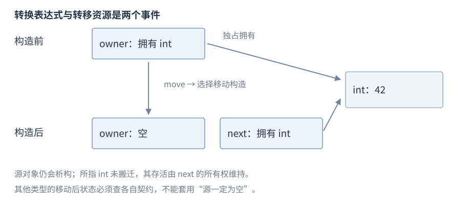
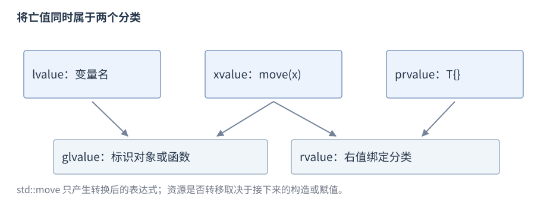

# 拷贝与移动

**拷贝**与**移动**是构造或赋值时选择的操作：**构造**建立新对象，**赋值**替换已有对象状态。移动允许接收源资源，具体转移和源状态由类型契约规定。

**版本**：C++17，尤其是同类型 prvalue 的直接构造。**先修**：[独占资源](R09-raii-memory.zh-CN.md#unique_ptr-构造与访问)、[引用](R05-pointers-references.zh-CN.md)、[特殊成员](R07-classes-lifetime.zh-CN.md#特殊成员函数)。先比较复制新对象与修改已有对象，再观察独占资源如何转交。值类别在本节连接表达式与操作选择；模板转发在模板节展开。

## 拷贝与移动操作分类

表中给常见签名形状，具体类可以受成员和基类条件限制。

| 操作 | 常见签名 | 目标关系 |
| --- | --- | --- |
| 拷贝构造 | `T(const T&)` | 建立新对象，按契约复制状态 |
| 拷贝赋值 | `T& operator=(const T&)` | 替换已有对象状态，处理目标旧资源 |
| 移动构造 | `T(T&&)` | 建立新对象，允许接收源资源 |
| 移动赋值 | `T& operator=(T&&)` | 替换已有状态，处理旧资源并接收源状态 |

默认操作逐个处理成员与基类；裸指针只复制地址，不自动深拷贝目标。共享句柄的拷贝可增加共同所有权，独占拥有者则通常禁止拷贝。固定数组可能逐元素移动，小字符串也可能复制内嵌字节，成本不能只由“移动”一词推断。

## 拷贝构造

用已有对象建立独立目标。先用 `<string>` 中的 `std::string` 保存文本，`copy[0]` 修改第一个字符；本例只需这一最小用法，完整字符串接口在标准库章展开。


```cpp
std::string source = "hello";
std::string copy(source);      // 拷贝构造
copy[0] = 'H';                 // copy 为 Hello，source 仍为 hello
```

字符串具有独立值语义；其他类型可能共享资源或保留借用，要查类型契约。构造目标之前不存在目标旧资源，复制失败时按构造失败规则清理已构造子对象。

## 拷贝赋值

给已经存在的目标赋予源状态；需 `<string>`：


```cpp
std::string source = "hello";
std::string target = "old";
target = source;              // 拷贝赋值，target 为 hello
source[0] = 'H';              // target 仍为 hello
```

赋值操作负责目标原状态和资源；自赋值和异常路径由实现及契约处理，不能把赋值等同于重新执行构造函数。

## std::move

`std::move` 来自 `<utility>`。把它写在 source 外面，表示允许后续操作选择移动路径；它本身只改变表达式的类别。先观察一次字符串构造，再区分表达式与对象。完整模板声明在模板节解释。


```cpp
std::string source = "hello";  // 需 <string>、<utility>
std::string target(std::move(source));
// target 为 hello；source 仍存活，可赋值或销毁
source = "again";
```

`move` 调用本身不转移资源、不搬内存、不结束源寿命；后续重载决定实际操作。



图：`unique_ptr` 的资源转移发生在移动构造；源拥有者对象仍存活但为空。这不是所有类型的通用移动后布局。

## 值类别

值类别（value category）描述某个表达式如何标识对象或产生值，与表达式的类型一起影响引用绑定和重载选择。三种基本类别互斥，另外两种是它们的组合：

| 类别 | 定义与例子 | 常见使用 |
| --- | --- | --- |
| 左值 lvalue | 标识对象或函数；`n`、`*p`、返回 `T&` 的调用 | 访问已有对象，绑定 `T&` 或适用的 `const T&` |
| 将亡值 xvalue | 标识资源可被复用的对象；对对象的 `std::move(n)`、返回 `T&&` 的调用 | 参与右值引用重载 |
| 纯右值 prvalue | 计算值或初始化结果对象；`42`、`n + 1`、`T{}`、返回 `T` 的调用 | 提供计算结果或初始化目标 |
| 泛左值 glvalue | lvalue 与 xvalue 的并集 | 表示对象或函数的身份 |
| 右值 rvalue | xvalue 与 prvalue 的并集 | 参与右值引用绑定等规则 |



图：lvalue 和 xvalue 组成 glvalue；xvalue 和 prvalue 组成 rvalue。分类表达身份与值的语义，不表示内存区域。

C++17 的类 prvalue 可直接初始化结果对象；需要对象身份的上下文才进行临时物化（temporary materialization），产生指向临时对象的 xvalue。例如 `const int& ref = 42;` 需要物化临时对象；其生命周期规则见[指针与引用](R05-pointers-references.zh-CN.md)。不能假定每个 prvalue 都先创建独立临时再拷贝。

用类型断言验证查询类型的写法见[值类别与类型查询](R10-templates-compile-time.zh-CN.md#值类别与类型查询)。

## 移动构造与移动赋值

以下使用 `<memory>`、`<utility>`，展示明确规定的独占所有权转交：


```cpp
auto source = std::make_unique<int>(42);
auto target = std::move(source); // 移动构造，source 为空
int value = *target;           // 42
auto old = std::make_unique<int>(7);
old = std::move(target);       // 移动赋值，旧 int(7) 被释放
// target 为空，old 拥有 int(42)
```

移动赋值不同于移动构造，因为已有目标可能要释放旧资源。显式写成 `= delete` 的移动函数仍参与重载，选中它会使调用非法；默认化后被定义为删除的移动构造或移动赋值会被重载决议忽略，右值因而可能走可用的 `const` 引用拷贝路径。根本没有适用移动时，也可能这样拷贝。

| 移动成员的情况 | 重载决议 | 从右值构造或赋值的可能结果 |
| --- | --- | --- |
| 未声明，且未隐式生成 | 没有移动候选 | 可选可用的 const 引用拷贝 |
| 显式 `= delete` | 仍作为候选 | 若它胜出，调用非法 |
| `= default` 后因成员或基类条件被定义为删除 | 忽略该移动候选 | 可选可用的 const 引用拷贝 |

下面使用 `<utility>`；类型定义放在命名空间作用域，使用语句放在函数体内。成员的显式删除移动会使外层默认化移动被定义为删除：

```cpp
struct Member {
    Member() = default;
    Member(const Member&) = default;
    Member(Member&&) = delete;
};
struct Outer {
    Member member;
    Outer() = default;
    Outer(const Outer&) = default;
    Outer(Outer&&) = default; // 被定义为删除，重载决议忽略
};
// 函数体内：
Outer source;
Outer copy(std::move(source)); // 选择 Outer(const Outer&)
// Member rejected(std::move(source.member)); // 非法：选中显式删除的移动
```

同样的忽略规则适用于默认化后被定义为删除的移动赋值。

对 `const` 对象调用 `move` 通常产生 `const T&&`，不能绑定常见 `T&&` 移动构造，因此可能复制或报错。`is_move_constructible` 为真只说明可从相应右值构造，不保证调用了移动函数。

## 移动后状态与借用

标准库对象通常移动后处于有效但未指定状态（valid but unspecified state），除非接口给出更强保证。其不变量仍成立，可以销毁、赋值及执行满足前置条件的操作；不能假定原内容不变或无条件调用 `front`/`pop_back`。`string` 不保证移动后为空，`unique_ptr` 明确保证适用所有权转移后源为空。

自定义类型须说明自己的移动后及自移动赋值契约，至少保持所承诺的不变量、避免泄漏或双重释放，不能从标准库默认约定推导自定义实现。只观察对象的函数不应无条件 `move`；需要原请求用于重试或日志时先保存必要信息。

移动也不普遍使外部借用跟随目标：借用源对象自身、内嵌成员或独立分配目标有不同关系；容器移动还受分配器与操作的失效条件影响。上例 `unique_ptr` 移动不搬迁其 `int`，源 `unique_ptr` 自身的引用却不会变成目标引用。

## 拷贝消除与返回对象

C++17 同类型类 prvalue 可以直接初始化结果对象，不要求先建立独立临时再移动；下面的不可复制不可移动类型仍可这样返回：


```cpp
struct Immovable {
    Immovable() = default;
    Immovable(const Immovable&) = delete;
    Immovable(Immovable&&) = delete;
};
Immovable make_value() { return Immovable{}; }
Immovable result = make_value();
```

析构函数仍须可访问且未删除。返回命名局部 `return local;` 的 NRVO（Named Return Value Optimization，具名返回值优化）允许但不强制；符合条件时不消除仍可能走隐式移动。通常直接返回 local，`return std::move(local);` 往往妨碍 NRVO。借用返回不因拷贝消除延长被借用对象寿命。


模板包装器如何保留调用者的值类别见[转发引用](R10-templates-compile-time.zh-CN.md#转发引用与引用折叠)和[std::forward](R10-templates-compile-time.zh-CN.md#stdforward)；按异常属性选择复制或移动见[move_if_noexcept](R11-errors-exception-safety.zh-CN.md#noexcept-与-move_if_noexcept)。

