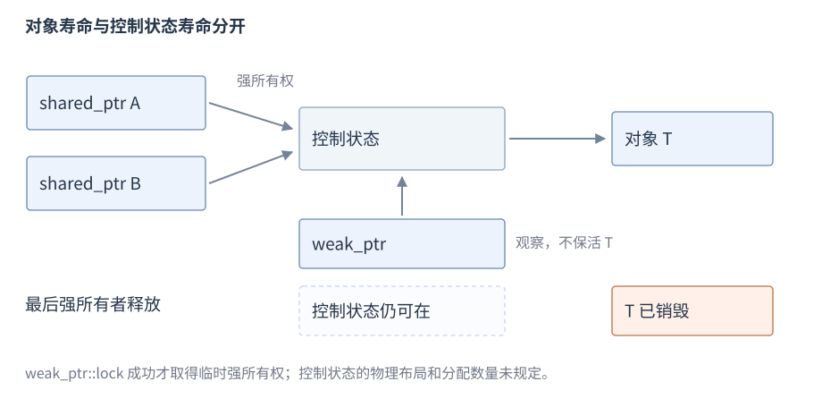
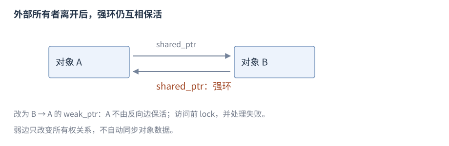
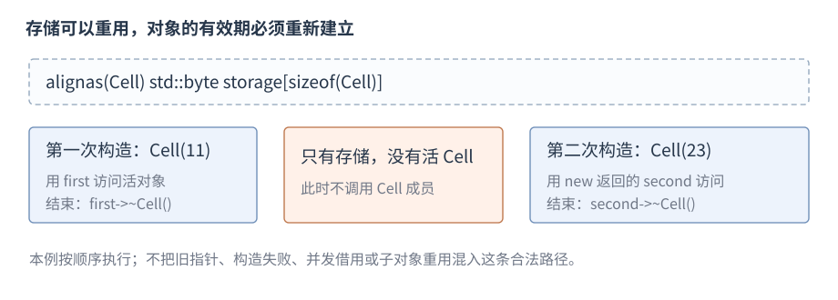

# RAII 与内存管理库

**RAII**（Resource Acquisition Is Initialization，资源获取即初始化）让对象持有资源，并在析构时释放。资源可以是内存、锁、文件或系统句柄；**所有权**（ownership）规定谁负责释放及何时转交。

**版本**：C++17，包含 pmr 多态分配设施。**先修**：[指针与引用](R05-pointers-references.zh-CN.md)、[类](R07-classes-lifetime.zh-CN.md)。本节先把正常作用域的自动清理扩展到资源，再介绍独占、共享与观察关系。所有权转交所用的 std::move 会先给出最小含义，下一节再完整比较拷贝与移动。

## RAII 资源对象

上一节的 Active 在作用域结束时恢复计数。RAII 把同一做法用于资源：取得资源的对象负责在析构时释放它，调用者只需保持对象活到最后一次使用。

先区分两个角色：**拥有者**承担释放责任，**借用者**只访问资源且不负责释放。例如一个对象保存动态分配的整数并负责删除；由它给出的 int* 只借用这个整数。指针的形状本身不能告诉我们谁拥有资源。

正常退出会析构自动对象。异常离开作用域时也会清理已经完成构造的自动对象，这叫栈展开。完整 throw/try/catch 规则在错误处理节展开；这里先用已介绍的类和指针完成资源取得与释放。

构造成功即拥有可用资源；取得资源后、交给拥有者前避免可能抛出的间隙。成员拥有者还能清理外层构造未完成时已取得的资源。析构通常保持不抛，需要报告的刷新/提交/关闭结果用显式操作提供，见[错误处理](R11-errors-exception-safety.zh-CN.md)。

## 正常退出与异常退出的清理

前节已经定义 Active：构造时把外部计数加一，析构时减一。下面沿用该类，用一次异常跳转观察同一析构路径；`std::runtime_error` 来自 `<stdexcept>`，保存一条失败说明。

```cpp
int count = 0;
try {
    Active active(count); // 构造完成，count 为 1
    throw std::runtime_error("failure");
} catch (const std::runtime_error&) {
    // 已离开 active 的作用域并完成析构，count 为 0
}
```

`try` 圈出可能失败的操作，`throw` 离开正常执行路径，匹配的 `catch` 接收这次异常。到达处理器前，已经完成构造的 active 被销毁。拥有内存或文件的成员也依靠析构完成对应清理；这不自动撤销已写出的文件内容等外部效果。这里先掌握“退出作用域仍执行清理”，异常类型、重新抛出和保证等级在错误处理节完整展开。

## new 与 delete

`new` 表达式通常取得存储并初始化对象；`delete` 表达式销毁对象并释放适用存储。以下在函数体内展示配对，不包含异常插入路径：


```cpp
int* value = new int(7);
int observed = *value;         // 7
delete value;
int* values = new int[3]{};    // 三个元素均为 0
values[1] = 9;
delete[] values;
```

`new/delete` 与 `new[]/delete[]` 分别配对；`malloc/free` 有自己的配对，不可混用。普通分配失败通常抛 `std::bad_alloc`，`new (std::nothrow) T` 在适用分配失败时返回空，需要 `<new>`，但构造函数自身抛出的异常仍可能传播。

分配函数 `operator new` 本身取得存储，不等于对象构造；构造失败按规则调用匹配释放函数。placement `new` 在已有存储建立对象，其对齐和生命周期规则见[类型与对象](R09-raii-memory.zh-CN.md#placement-new-与存储重用)。日常代码优先容器或 make 系列，把裸拥有指针保留在确需表达转交的接口边界。

## 智能指针分类

下面使用 `<memory>`。**智能指针**是管理或观察对象关系的库类型，不把所有裸指针都自动变成拥有者。

| 类型 | 所有权 | 主要操作组 |
| --- | --- | --- |
| `unique_ptr<T,D>` | 独占，可移动转交 | 构造、访问、reset/release、删除器 |
| `shared_ptr<T>` | 多个句柄共享释放责任 | 构造、复制/移动、访问、reset、所有权观察 |
| `weak_ptr<T>` | 观察共享关系，不保活 | 从 shared/weak 构造、lock、expired、reset |

下面按具体类型提供入口。默认删除器适用时负责 `delete`/`delete[]`，自定义删除器则按资源来源释放。

## unique_ptr 构造与访问

`std::unique_ptr<int>` 表示独占拥有一个 int 的对象：`<int>` 选择所管理的类型，并不是整数值。它来自 `<memory>`，类型自 C++11 提供，下面建立目标的 `make_unique` 自 C++14 提供。先用默认删除策略观察构造与访问。空构造/`nullptr` 构造建立空拥有者；指针构造接收所有权；移动构造转交；拷贝构造被删除。


```cpp
std::unique_ptr<int> empty;
auto owner = std::make_unique<int>(7); // C++14：建立初值为 7 的 int 并返回拥有者
int* borrowed = owner.get();   // 只借用，不释放
int value = *owner;            // 7
bool present = static_cast<bool>(owner); // true
```

接口形状为 `template<class T, class D = std::default_delete<T>> class unique_ptr;`。这里只需把 T 读成目标类型、D 读成释放策略；完整模板语法在模板节展开，下面的数组与删除器条目再展示 D 的使用。

`get()` 返回存储指针，`operator bool` 检查它是否非空；`*` 和 `->` 访问有效目标，空指针不能解引用。传 `get()` 给其他接口不转交所有权，不应让接收者独立释放它。默认删除器实际删除时要求 `T` 完整，PImpl 通常在实现类型可见的源文件定义拥有者析构。

## unique_ptr 转移、reset 与 release

把 `std::move(source)` 交给另一个独占拥有者，允许它接收 source 的资源。`move` 来自 `<utility>`，本身不释放、不搬运对象；这里实际的转交由 unique_ptr 的移动构造完成。下面同时比较转交、替换与解除管理，使用 `<memory>`、`<utility>`：


```cpp
auto source = std::make_unique<int>(7);
auto target = std::move(source); // source 为空，target 拥有原对象
target.reset(new int(9));      // 释放旧 int，接收新的 int
int* transferred = target.release(); // target 为空；未释放 int
std::unique_ptr<int> received(transferred); // 接收者重新管理
received.reset();              // 释放 int，received 为空
```

`reset(p)` 用删除器释放旧目标并保存 p，默认 p 为空；`release()` 只取出指针且清空拥有者，调用者负责立即转交或重新接管。转交接口若失败且未接收资源，责任仍在调用方。`swap` 交换指针和删除器状态，`get_deleter()` 取得删除器引用；不要用 `reset(get())` 制造指向已释放对象的状态。

## 拥有资源的 lambda 捕获

初始化捕获 `[p = std::move(owner)]` 直接建立闭包中的资源，可转入所有权，闭包可能不可拷贝。按值捕获副本中的指针/引用仍可能借用外部对象，是否自足取决于成员所有权。捕获 `unique_ptr` 的闭包通常不可拷贝，不能在 C++17 直接保存进 `std::function`；局部用 `auto` 或模板形参可保留原闭包类型。共享所有权的捕获仍可能造成循环。

完整[值捕获与拥有资源闭包程序](../examples/r06-statements-functions.cpp)保留 `make_adder` 和初始化捕获的组合：返回的整数副本捕获仍有效，`make_unique` 的资源被转入不可拷贝闭包，再通过 `invoke` 调用。若把函数局部参数改成引用捕获，函数返回后该借用失效。

## unique_ptr 数组与删除器

`unique_ptr<T[]>` 使用数组删除并提供 `operator[]`，不携带长度，仍须由接口保存和检查边界：


```cpp
auto values = std::make_unique<int[]>(3); // 需 <memory>，元素初值为 0
values[1] = 7;
int value = values[1];         // 7
```

删除器 `D` 是类型的一部分，可以把正确的标准或平台释放函数绑定到拥有者。需要 `<cstdio>`、`<memory>` 的定义和局部使用：


```cpp
struct FileCloser {
    void operator()(std::FILE* file) const noexcept {
        if (file) std::fclose(file);
    }
};
std::unique_ptr<std::FILE, FileCloser> file(std::fopen("data.txt", "r"));
// file 为空表示未打开；离开作用域时关闭已取得的文件
```

例子只演示清理；需要向调用者报告关闭失败的接口应显式关闭并处理状态。删除器依赖的上下文也需活到调用时；模块/DLL/插件间资源按协议由对应模块或提供的删除器释放，标准不保证任意运行库兼容。

## 资源拥有者作为成员

现在把数组拥有者放进类。`Buffer` 的构造函数建立 data，类本身不需要手写析构；data 的析构会删除数组。下面使用 `<cstddef>` 与 `<memory>`：

```cpp
struct Buffer {
    std::unique_ptr<int[]> data;
    explicit Buffer(std::size_t n) : data(std::make_unique<int[]>(n)) {}
};
// 使用片段
{
    Buffer buffer(3);          // 取得三个值初始化的 int
    buffer.data[0] = 7;
}                             // 析构释放数组
```

外层构造后续步骤若失败，已经完成构造的 data 也会销毁。这样资源从取得时就进入一个能自动清理的对象。

## 切片、克隆与外部表示

按值复制派生对象到 `Base` 只复制基类状态；标准库章中的 `vector<Base>` 按值保存 Base，不能保存每个元素的派生动态类型。混合动态类型可以用一组具有适当虚析构的 `unique_ptr<Base>` 保存；独立多态复制可定义 `clone` 返回拥有者，由各派生实现自己的完整复制。

需要 `<memory>` 的完整接口及一个实现：


```cpp
struct Cloneable {
    virtual ~Cloneable() = default;
    virtual std::unique_ptr<Cloneable> clone() const = 0;
};
struct Value final : Cloneable {
    int number = 7;
    std::unique_ptr<Cloneable> clone() const override {
        return std::make_unique<Value>(*this);
    }
};
```

`*this` 表示当前 Value 对象；工厂以它为初值复制建立一个新的 Value。返回时，拥有派生对象的 `unique_ptr<Value>` 转换为接口需要的 `unique_ptr<Cloneable>`，仍管理这个完整 Value，虚析构保证经基类接口正确销毁。对 `Value` 调用 clone 因而得到独立的 Value，保留动态类型并由 unique_ptr 管理返回对象。

固定类型集合可用[variant](R17-utility-results.zh-CN.md)。合法多态复制使用构造与资源操作，不能按字节复制虚指针；序列化使用类型标签、字段和版本，无法把进程内虚表地址、指针和所有权直接恢复到另一个进程。

保存 `this` 的回调需要把注销、在途调用结束与销毁连接起来；析构中注销不自动证明其他线程已经停止调用。对象发布和任务关闭由[异步执行](R23-async-execution.zh-CN.md)展开。

## shared_ptr 构造、共享与访问

下面使用 C++11 的 `<memory>`。声明形状是 `template<class T> class shared_ptr;`。默认构造为空；可从适用裸指针（及可选删除器）、`unique_ptr`、`shared_ptr` 或有效 `weak_ptr` 构造；常用 `make_shared` 建立对象与共享关系。


```cpp
auto owner = std::make_shared<int>(42);
auto copy = owner;             // 共同所有权
int value = *copy;             // 42
long owners = owner.use_count(); // 本同步局部例中为 2
owner.reset();                // copy 仍保活对象
copy.reset();                 // 最后强所有者离开，销毁对象
```

`get/*/->/operator bool` 检查和访问存储指针，`reset` 清空或替换此句柄，`swap` 交换状态；复制增加共同所有权，移动转交句柄。`shared_ptr` 没有 `unique_ptr` 式的 `release()`。不要从同一已管理裸指针独立构造两个共享关系，`shared_ptr(owner.get())` 会造成重复管理。

别名构造可共享完整拥有者却保存子对象指针，所有权与 `get()` 不等同。适用的所有权比较用 `owner_before`，不能只据相同存储指针判断同一所有权关系；`get_deleter<D>` 是自由函数，用于查询适用删除器。

## weak_ptr 构造、lock 与 expired

下面使用 C++11 的 `<memory>`。声明形状是 `template<class T> class weak_ptr;`，它从共享关系建立观察，不计为强所有者。


```cpp
auto owner = std::make_shared<int>(42);
std::weak_ptr<int> observer = owner;
auto kept = observer.lock();   // 成功，得到临时强所有者
owner.reset();                // kept 仍保活 int
kept.reset();                 // int 销毁
bool gone = observer.expired(); // true
auto missing = observer.lock(); // 空 shared_ptr
```

`lock()` 将检查和取得强所有权合为一个操作，失败返回空 `shared_ptr`，不抛异常；`expired()` 等价于检查强计数是否为零，不保活。先 `expired` 再使用裸指针会留下状态改变窗口，应直接 `lock` 并检查结果。`use_count` 查询强所有者数量，`reset/swap/owner_before` 分别清空、交换和比较所有权。它没有直接解引用操作。

## make_unique、make_shared 与 allocate_shared

下面使用 `<memory>`。工厂函数把调用者给出的实参用于对象构造，并返回已管理的拥有者。前面的 `<int>(7)` 就是在建立一个初值为 7 的整数。以下保留省略约束的接口形状供查阅；其中 `Args...` 表示一组构造实参，转发机制在模板节的参数包与 std::forward 中展开：


```cpp
// template<class T, class... Args> unique_ptr<T> make_unique(Args&&...); // C++14
// template<class T, class... Args> shared_ptr<T> make_shared(Args&&...); // C++11
// template<class T, class Alloc, class... Args>
// shared_ptr<T> allocate_shared(const Alloc&, Args&&...);              // C++11
```

单对象 `make_unique` 转交构造实参，未知界数组 `make_unique<T[]>(n)` 值初始化 n 个元素，已知界数组形式被删除。C++17 `make_shared`/`allocate_shared` 的这里展开范围是非数组对象；数组扩展须按后续版本查阅。`allocate_shared` 使用提供的分配器管理相关分配。


```cpp
struct Item { int value; explicit Item(int n) : value(n) {} };
auto unique = std::make_unique<Item>(7);
auto shared = std::make_shared<Item>(42);
// 指定分配器的 allocate_shared 用法在下方 allocator 条目给出。
```

`make_shared` 常见实现把对象与控制状态共同分配，减少分配次数；标准不规定控制块字段布局或每次恰好一次分配。自定义删除器通常用相应 `shared_ptr` 构造，不能任意传给 `make_shared`。

## 控制状态、循环与并发

控制状态管理共享对象的释放关系；最后一个强所有者离开会销毁对象，弱观察所需的控制状态仍可存在。



图：对象析构与控制状态结束是不同事件；合并分配的实现中，尚存弱引用可能使相关存储保持更久。对象析构、分配器归还与进程驻留内存下降也不是同一事件。



图：两个节点互存强所有者会保活彼此；把反向关系改成 `weak_ptr` 可切断强环，访问时处理 `lock` 失败。

不同 `shared_ptr` 句柄的控制状态更新可以安全并发，不意味着同一个句柄变量可以无保护读写，更不意味着所指对象线程安全。一次 `use_count` 为一不能证明无人访问，其他线程可经 `weak_ptr` 取得新句柄，裸借用也不计数；同步及原子共享指针的版本边界见[原子共享指针](R22-atomics-memory-order.zh-CN.md#原子共享指针)。

## enable_shared_from_this

下面使用 `<memory>`。`enable_shared_from_this<T>` 为适当纳入共享所有权的对象提供 `shared_from_this()`；C++17 还提供 `weak_from_this()`。使用公开、适用的唯一基类关系：


```cpp
struct Node : std::enable_shared_from_this<Node> {
    std::shared_ptr<Node> self() { return shared_from_this(); }
};
auto node = std::make_shared<Node>();
auto same_owner = node->self(); // 共享 node 的已有控制关系
```

调用时适用共享关系必须已经建立，构造函数中不能先假定它已存在；没有可用关系的 `shared_from_this` 会抛 `std::bad_weak_ptr`。`shared_ptr(this)` 则新建独立管理关系，不能作为替代。

## placement new 与存储重用

例中的 `alignas(Cell)` 要求存储满足 Cell 的对齐，`std::byte` 表示原始字节；数组在这里仅提供存储。

普通 `new T(...)` 安排分配和初始化；标准 placement `new` `::new (address) T(...)` 在调用者提供的存储中建立对象，不取得这块存储。以下展示先后两次构造，需要 `<cstddef>`、`<new>`，放在函数体内：


```cpp
struct Cell { int value; explicit Cell(int v) noexcept : value(v) {} };
alignas(Cell) std::byte storage[sizeof(Cell)];
Cell* first = ::new (static_cast<void*>(storage)) Cell(11);
int first_value = first->value;    // 11
first->~Cell();
Cell* second = ::new (static_cast<void*>(storage)) Cell(23);
int second_value = second->value;  // 23
second->~Cell();
```

按以下过程管理存储，条件跟随各阶段：

1. 准备足够大小、正确对齐且存储期足够长的空间。
2. 执行 placement 构造，保存返回的新指针；若构造抛出异常，该次对象未完成构造。
3. 在对象生命周期内访问，并遵守类型访问和同步要求。
4. 对需清理的类型执行析构，结束借用；析构不释放这里的字节数组。
5. 重用时重新构造，或按原存储来源释放；不能对数组槽中的 placement 对象调用普通 `delete`。



图：两次构造之间没有存活的 Cell；每次使用当次构造返回的指针。手工槽位需维护是否有活对象，构造失败和异常退出也要清理已存在对象；普通代码优先使用[RAII](R09-raii-memory.zh-CN.md)。

C++17 旧指针自动指向替换对象的条件涉及完整对象、`const` 和子对象等。`std::launder` 只在规定条件下取得指向新对象的指针，不创建对象、不修正对齐，也不修复悬垂借用。

完整[字节复制与存储重用程序](../examples/r02-object-storage.cpp)保留析构计数等组合说明。

## allocator 与 allocator_traits

下面使用 `<memory>`。`allocator` 管理原始存储，`allocator_traits` 统一调用分配、构造、销毁与释放。示例的 `int` 构造不抛，先取得存储再建立对象：


```cpp
std::allocator<int> allocator;
using Traits = std::allocator_traits<std::allocator<int>>;
int* slot = Traits::allocate(allocator, 1);
Traits::construct(allocator, slot, 7);
int value = *slot;             // 7
Traits::destroy(allocator, slot);
Traits::deallocate(allocator, slot, 1);
```

`allocate(n)` 取得适用存储，`construct` 建立对象，`destroy` 结束对象，`deallocate(p,n)` 按来源归还。通常由容器执行这些操作；泛化到可抛构造须清理未完成步骤。自定义分配器还要满足相等性、传播与类型等条件，不能仅实现 `allocate` 就推导移动/`swap` 安全。

## 指定分配器建立共享对象

已经区分了取得存储与建立对象，现在可以用 allocate_shared 指定相关分配所用的分配器。以下使用 <memory>：

```cpp
struct Item { int value; explicit Item(int n) : value(n) {} };
auto allocated = std::allocate_shared<Item>(std::allocator<Item>{}, 9);
```

allocated 拥有 value 为 9 的 Item。分配器决定相关存储如何取得和归还；共享所有权仍按前述强、弱所有者规则管理。

## memory_resource 与 polymorphic_allocator

下面使用 C++17 的 `<memory_resource>`。`std::pmr::memory_resource` 是分配策略的抽象接口，公开 `allocate(bytes, alignment)`、`deallocate(p, bytes, alignment)`、`is_equal(other)`；派生资源实现相应虚函数。调用者匹配字节数、对齐及资源来源。

`template<class T> class std::pmr::polymorphic_allocator` 保存 `memory_resource` 的借用，把分配请求转交给它；`std::pmr::vector<T>` 等别名据此在运行期选择资源。资源不替容器管理元素值或并发访问。

## monotonic_buffer_resource 与池资源

`std::byte` 表示原始字节；下例的字节数组只提供存储，不把字节当成已构造的整数。

C++17 中，`monotonic_buffer_resource` 以递增批次取得空间，单次 `deallocate` 不回收单块，整体 `release` 或销毁统一释放。这里先借用 `std::pmr::vector<int>` 作为动态整数数组：`values(&arena)` 指定它借用 arena 分配，`push_back(7)` 追加一个元素。容器的完整接口在顺序容器节展开；当前只观察容器与分配资源的寿命关系。代码使用 `<cstddef>`、`<memory_resource>`、`<vector>`：


```cpp
std::byte buffer[1024];
std::pmr::monotonic_buffer_resource arena(buffer, sizeof buffer);
{
    std::pmr::vector<int> values(&arena);
    values.push_back(7);
}                             // 先销毁元素和容器
arena.release();              // 再释放资源管理的分配
```

资源必须比借用它的容器活得久，`release` 不替元素执行析构。初始缓冲用尽后可转向上游，不能凭提供缓冲保证全程不再分配；以 `null_memory_resource()` 作为上游可形成拒绝后续分配的边界，失败会抛 `bad_alloc`。

`unsynchronized_pool_resource` 以池复用不同大小的分配，不可据此无锁跨线程共享；`synchronized_pool_resource` 支持其分配接口的适用并发，仍不保护容器业务操作。两种池的构造、`release`、`upstream_resource` 等用于低频策略查询，具体调优不展开。

## 配套所有权例子

完整[独占转移、共享保活与弱观察程序](../examples/r09-raii-memory.cpp)保留存活计数：`lock` 得到的强所有者可跨一个 `shared_ptr.reset` 保活对象，最后强所有者离开后弱引用过期。三个智能指针的常用操作由本节各自条目维护，平台内存与模块边界见[进程与虚拟内存](R25-process-virtual-memory.zh-CN.md)和[库与装载](R27-linking-loading-libraries.zh-CN.md)。

