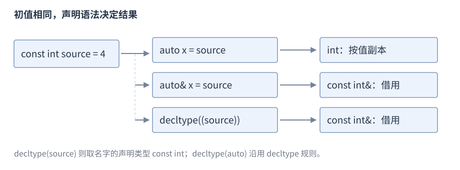
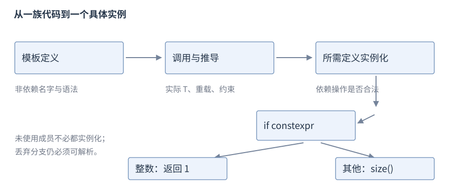

# 模板与编译期编程

**模板**（template）描述一族函数或类型；模板实参替换参数后形成具体实例。编译期编程使用类型、常量表达式及约束，在翻译时选择适用实现。

**版本**：核心为 C++17；concepts/`requires` 标 C++20。**先修**：[类型推导](R03-initialization-deduction.zh-CN.md)、[函数](R06-statements-functions.zh-CN.md)、[类](R07-classes-lifetime.zh-CN.md)。先把普通函数和类推广成一族函数与类型，再解释推导与转发。类型查询、编译期选择、查找和约束在具备这些基础后展开。

## 函数模板

形状是 `template<class T> 返回类型 函数名(参数)`；模板参数 `T` 在定义中代表待确定的类型。


```cpp
template<class T>
T twice(T value) { return value + value; }
// 使用片段
int integer = twice(3);        // T 推导为 int，结果 6
double real = twice(1.5);      // T 为 double，结果 3.0
long explicit_type = twice<long>(3); // 显式给 T
```

同一模板可生成多个适用函数，不是运行时根据类型切换。示例选用可表示结果；模板能实例化不表示任意数值输入都有效。类型为具体使用提供所需操作，本模板要求 `value + value` 及返回转换适用。

## 泛型 lambda

泛型 lambda 的参数可写 `auto`（C++14 起），其调用运算符按参数类型实例化。下面的每次调用都按对应实参类型生成适用操作：

```cpp
auto twice = [](auto value) { return value * 2; };
int integer = twice(3);       // 6
double real = twice(2.5);     // 5.0
```

## 类模板

形状为 `template<class T> class Name { ... };`，类名后通常写实参。


```cpp
template<class T>
struct Box {
    using value_type = T;
    T value;
    explicit Box(T initial) : value(initial) {}
    const T& read() const { return value; }
};
Box<int> integer{7};
Box<double> real{2.5};
```

`Box<int>` 与 `Box<double>` 是不同类型；成员操作依赖 `T`。隐式实例化类不意味着所有成员函数体立即实例化，能声明某类型的 `Box` 不代表其所有操作都可用。

## constexpr、consteval 与 constinit

**`const`** 限制通过该对象修改值，初始化可以在运行期；对指针需区分指针自身与所指对象的 `const`。**`constexpr`** 变量要求常量初始化并具有 `const` 属性，`constexpr` 函数允许适用调用参与常量表达式。

```cpp
constexpr int square(int n) { return n * n; }
constexpr int known = square(3); // 9，常量表达式
int input = 4;
int runtime = square(input); // 16；也可接受运行期输入
```

`constexpr` 函数不保证每次调用都在编译期执行；结果仍须满足常量表达式规则，包括不进行禁止的操作。`const` 也不自动使任意对象可用于常量表达式。

### consteval 与 constinit

**C++20**。**`consteval`** 声明**立即函数**（immediate function），适用的立即调用须形成常量表达式；**`constinit`** 要求静态或线程存储期变量满足静态初始化，不把变量变为 `const`。

```cpp
consteval int twice(int value) { return value * 2; }
constexpr int known = twice(21);       // 42
constinit int global_count = 0;        // 命名空间作用域，可在运行期修改
```

`constinit` 不保证变量可用作常量表达式，且不能与 `constexpr` 在同一声明中组合。上例的立即函数输入有界；概念或常量求值不能替代任意运行时数据的验证。

## 模板参数类别

类型参数用 `class`/`typename`，非类型参数接收规定种类的常量，模板模板参数接收适用的模板。

| 类别 | 声明形状 | 常见作用 |
| --- | --- | --- |
| 类型参数 | `template<class T>` | 元素或操作对象类型 |
| 非类型参数 | `template<std::size_t N>` | 固定长度、编译期选项 |
| 模板模板参数 | `template<template<class> class C>` | 接收符合参数形状的模板 |
| 参数包 | `template<class... T>` | 零个或多个类型 |

这里的 `static_assert` 是编译时断言：条件必须是编译时可判定的常量，条件为假时程序不能通过翻译。例中检查 N 大于零，随后才以 N 建立数组；完整条件分支与诊断规则稍后展开。代码使用 `<cstddef>`：


```cpp
template<class T, std::size_t N>
struct Buffer {
    static_assert(N > 0, "positive extent required");
    T elements[N];
};
Buffer<int, 3> values{{1, 2, 3}};
```

参数可有适用默认值；C++17 非类型模板参数可用 `auto` 推导其类型，类类型参数等后续扩展按版本查阅，不混入本节基线。

## 模板实参推导

函数调用通常从实参推导模板参数，返回类型通常不能单独帮助一次函数调用推导。形参是值还是引用影响顶层 `const`、引用与数组转换，见[auto](R03-initialization-deduction.zh-CN.md#auto)及[转发引用](R10-templates-compile-time.zh-CN.md#转发引用与引用折叠)。


```cpp
template<class T> T choose(T first, T second) { return first; }
int chosen = choose(3, 7);     // T 为 int
// choose(3, 2.5);             // 两侧推导不一致，不自动找共同类型
double real = choose<double>(3, 2.5); // 显式 T，普通转换适用
```

模板推导与后续转换是不同步骤。重载集、花括号和不推导上下文会限制推导，不能由目标返回变量类型随意猜测所有参数。

## 转发引用与引用折叠

形如 `template<class T> void f(T&&)` 的函数模板中，`T` 是推导的无 cv 模板类型参数时，`T&&` 可以是**转发引用**（forwarding reference）。**传左值**时 `T` 可推导为引用，**传右值**时可推导为非引用类型。

| 引用组合 | 折叠结果 | 常见来源 |
| --- | --- | --- |
| `T& &`、`T& &&`、`T&& &` | `T&` | 参数推导或类型别名替换 |
| `T&& &&` | `T&&` | 右值引用的组合 |

这描述替换过程的类型组合，不是可以直接写任意相邻引用符号的普通声明。类模板已经确定的 `T&&`、`const T&&`、非模板右值引用不能套用同一种推导。参数名在函数体内仍是左值表达式。

## auto 的完整推导与列表初值

**`auto`** 根据初值推导类型，常见形状是 `auto name = expression`、`auto& name = expression`、`auto&& name = expression`。需要初值，不能仅声明 `auto object;`。

```cpp
const int source = 4;
auto copy = source;           // int，按值副本
const auto constant = source; // const int
auto& alias = source;         // const int&
auto&& reference = source;    // const int&，初值是左值
const int* pointer = &source;
auto pointer_copy = pointer; // const int*，底层 const 保留
```

按值推导通常移除引用和顶层 `const`，数组/函数也可能转换为指针；引用推导保留相关 `const` 和数组身份。`auto&&` 在这里按转发引用规则推导，详见本节[转发引用与引用折叠](#转发引用与引用折叠)。需要借用时写出引用，避免不必要地复制容器。



图：以 `const int` 左值为初值，推导的复制/借用关系不同；图不规定优化后是否实际保存副本。

C++17 `auto a{1};` 推导为 `int`；`auto b = {1};` 推导为 `std::initializer_list<int>`，需要相应头文件。直接列表推导要求单个元素；拷贝列表各元素需能推导同一种元素类型，不能凭列表自动创造某种容器。

## decltype 与 decltype(auto) 的完整推导

**`decltype(expression)`** 查询类型，不求值表达式。对未加括号的名字或成员访问，取得实体的声明类型；其他表达式按[值类别](R08-copy-move.zh-CN.md#值类别)得到 `T`、`T&` 或 `T&&`。

```cpp
const int source = 4;
decltype(source) copy = 7;     // const int
decltype((source)) alias = source; // const int&
decltype(source + 1) value = 5; // int，prvalue
decltype(auto) borrowed = (source); // const int&
```

括号改变是否适用名字的特殊规则；**`decltype(auto)`** 使用这套规则保留类型属性，不使用普通按值 **`auto`** 的规则。函数返回 `decltype(auto)` 时，`return (local);` 可推导为**引用**，函数退出后悬垂；`return local;` 可推导为**值**。先确定返回所有权，避免用括号偶然决定接口。

## std::move 的声明形状

在拷贝与移动节已经使用过 `std::move`。现在可以读它省略细节后的声明：`template<class T> std::remove_reference_t<T>&& move(T&& value) noexcept`。`remove_reference_t<T>` 来自 `<type_traits>`，移除 T 中的引用部分；结果再加 `&&`。返回表达式允许后续重载选择移动，但函数自身不转移资源。异常说明符的完整含义在错误处理节展开。

## std::forward

下面使用 `<utility>`。`std::forward<T>(value)` 根据已经推导的 `T` 恢复调用者的值类别。接口摘要有接受 `remove_reference_t<T>&` 和 `remove_reference_t<T>&&` 两种形式，结果为 `T&&`，均为 `noexcept`；右值形式不能用于把右值错误地转成左值。


```cpp
int category(int&) { return 1; }
int category(int&&) { return 2; }
template<class T>
int relay(T&& value) {
    return category(std::forward<T>(value));
}
// 使用片段
int value = 7;
int first = relay(value);      // 1，转发左值
int second = relay(7);         // 2，转发右值
```

对明确要消费的对象用 `move`，对包装调用中的推导参数用 `forward`。重复 `forward` 同一个右值可能重复消费；完美转发（perfect forwarding）仍不能自动推导花括号列表、消除重载集歧义或引用不允许绑定的位域。

## 类模板实参推导

C++17 中，类模板实参推导（Class Template Argument Deduction，CTAD）根据适用构造和推导指引省略模板实参。使用前述带构造的 `Box`：


```cpp
Box inferred{7};              // 推导为 Box<int>
```

推导指引描述构造参数与目标实例的关系，不是构造函数实现。C++17 聚合不能随意依赖 C++20 的聚合推导候选；必要时提供显式指引或写出实参。

## 实例化与定义可见性

**实例化**（instantiation）用具体实参形成所需声明/定义。隐式实例化通常需要调用处看见模板定义，故模板常放在头文件；只放声明在头而把通用定义藏在源文件，其他单元使用新类型时可能缺定义。



图：先检查可以确定的语法和非依赖名字，使用时进行推导、匹配及所需实例化；不表示所有成员立刻生成机器码。

有限的已知类型集合可用显式实例化集中生成；以下示意应放在已经能看见前述 twice 定义的实现位置：


```cpp
template int twice<int>(int); // 显式实例化定义
// 接口中的对应声明可写 extern template int twice<int>(int);
```

`extern` `template` 抑制相应隐式实例化，但需要程序中提供所需实例化定义；它不是任意隐藏通用实现的方式。重复解析会影响构建时间，稳定的非泛型部分可移出模板。头受不同宏影响形成不同定义还可能违反[ODR](R01-program-build.zh-CN.md#单一定义规则与多文件程序)。

## 类、模板与 inline 的单一定义规则

同一翻译单元内不能重复定义规定的实体；被 odr-use 的普通非 `inline` 函数或变量在整个程序中需要相应定义。odr-use 表示按标准规定的使用需要实体定义，例如通常的函数调用或变量取址；不是所有只提到名字的场合都需要定义。类、模板和 `inline` 实体允许满足条件的多单元定义，包括相同记号序列及相应名字查找一致；某些跨单元违例不要求诊断。类内定义的成员函数隐式 `inline`，类外定义另行判断。

## 全特化与偏特化

**全特化**为确定实参提供专用定义，**类模板偏特化**为一族实参形状提供定义。


```cpp
template<class T> struct Tag { static constexpr int kind = 0; };
template<> struct Tag<int> { static constexpr int kind = 1; };
template<class T> struct Tag<T*> { static constexpr int kind = 2; };
int ordinary = Tag<double>::kind; // 0
int integer = Tag<int>::kind;     // 1
int pointer = Tag<int*>::kind;    // 2
```

特化应在触发相应隐式实例化前可见。函数模板不能偏特化，通常用函数重载或其他定制方式；不要任意向 std 添加普通重载，标准允许的定制需逐个核对。

## 依赖名、typename 与 template

依赖名（dependent name）依赖模板参数，例如 `T::value_type`。`typename` 告知解析器相应限定名是类型，`template` 告知相应依赖成员是模板；它们不创建缺失接口。


```cpp
template<class B>
typename B::value_type read(const B& box) { return box.value; }

template<class T>
auto request(T& object) { return object.template get<int>(); }
```

`read` 要求 `B` 有适用 `value_type` 和可返回 `value`；`request` 要求 `T` 提供适用成员模板 `get`。非依赖名字通常在模板定义处查找，依赖名字按相应定义/实例化规则处理，不能把所有名字查找都推迟到使用处。

## 实参相关查找

**实参相关查找**（Argument-Dependent Lookup，ADL）为适用的未限定函数调用加入实参关联类及命名空间中的候选。通用 `swap` 常把标准后备与定制共同纳入：


```cpp
// 需 <utility>；模板要求 a、b 满足适用交换条件
template<class T>
void exchange(T& a, T& b) {
    using std::swap;
    swap(a, b);
}
```

直接限定 `std::swap` 会关闭这个未限定查找路径；ADL 也不是在所有命名空间搜索同名函数。

## 参数包与折叠表达式

C++17 的折叠表达式中，参数包表示零个或多个参数，包展开把一个模式应用到各元素。二元左折叠用显式起点支持空包：


```cpp
template<class... T>
auto sum(T... values) { return (0 + ... + values); }
int empty = sum();            // 0
int total = sum(1, 2, 3);      // 6
```

起点类型参与通常算术转换，不是任意精度求和。一元空包仅对规定运算符有单位结果，不是所有运算符都能省略起点。折叠结合方向与求值顺序仍按相应运算符规则判断。

## std::invoke 的成员指针与转发接口

下面使用 C++17 的 `<functional>`。省略约束和异常说明后的接口形状为 `template<class F, class... Args> decltype(auto) invoke(F&& f, Args&&... args)`。它统一调用普通可调用对象和成员指针，返回目标操作的结果。


`&Counter::add` 取得选择 `add` 成员函数的成员指针，`&Counter::value` 取得选择数据成员的成员指针；它们没有绑定某一个对象。传给 `invoke` 的 `counter` 提供本次操作的对象，因此前者调用函数，后者返回该对象成员的引用：

```cpp
struct Counter { int value = 7; int add(int n) const { return value + n; } };
Counter counter;
int answer = std::invoke(&Counter::add, counter, 3); // 10
int& member = std::invoke(&Counter::value, counter); // 借用成员
member = 9;                   // counter.value 为 9
```

可接受适用对象、指针或 `reference_wrapper` 等形式；它不延长对象寿命，也不吞掉目标异常，同步调用的异常传播给调用者。

## std::function 的签名模板

声明形状是 `template<class R, class... Args> class function<R(Args...)>`；模板实参是调用签名。它通过类型擦除（type erasure）把不同类型的可调用目标保存在同一种包装类型中。实际调用与空状态条件见[std::function](R06-statements-functions.zh-CN.md#stdfunction)。

## if constexpr 与 static_assert

**类型特征**是标准库提供的类型属性查询。`std::is_integral_v<T>` 来自 `<type_traits>`，结果是 T 是否为整数类型的布尔常量；它查询类型，不查询某次传入的数值。

C++17 中，`if constexpr` 在适用实例化中按常量条件丢弃分支。需要 `<cstddef>`、`<type_traits>`：


```cpp
template<class T>
std::size_t extent(const T& value) {
    if constexpr (std::is_integral_v<T>) return 1;
    else return value.size();
}
```

整数路径不要求 `size`；其他类型需有可转换为 `size_t` 的 `size()`。丢弃分支仍需能解析，非依赖错误不能任意隐藏；模板外也不能把分支视作注释。

`static_assert(条件, "诊断")` 在翻译时验证常量条件。C++17 中不支持类型的断言宜依赖模板参数，使诊断在相应实例化发生；类型特征只判断类型属性，不验证运行时输入或数值边界。

## 类型特征与字节复制

`<type_traits>` 的特征回答特定语言问题，不能把“简单结构”当作所有底层操作都合法的证明。

| 特征 | 可以判断 | 不保证 |
| --- | --- | --- |
| `is_trivially_copyable_v<T>` | 适用对象可使用规定的字节复制保证 | 外部字节有效、可跨进程传指针、格式稳定 |
| `is_standard_layout_v<T>` | 满足标准布局条件，适用时可用 offsetof | 无填充、固定大小或跨编译器 ABI 一致 |
| `is_trivial_v<T>` | 平凡默认构造等更强条件 | 默认初始化得到业务有效值 |

下面在两个已经构造的同类型完整对象间复制表示，得到相同值；需要 `<cstring>`、`<type_traits>`，放在函数体内：


```cpp
struct Record { int value; unsigned char tag; };
static_assert(std::is_trivially_copyable_v<Record>);
Record source{7, 2}, copy{};
std::memcpy(&copy, &source, sizeof source); // copy.value 为 7，tag 为 2
```

C++17 保证符合条件的平凡可复制对象可复制到字符/字节数组再恢复，或在适用的现存同类型对象之间复制；基类子对象等有排除条件。本例使用非 `volatile` 的完整对象，源目标不重叠。标准布局与平凡可复制不能互换；带指针的平凡可复制记录仍可能借用同一个目标。`string`、`vector`、多态资源对象的复制应使用类型提供的操作。

## 值类别与类型查询

`std::is_same_v<A,B>` 是 `<type_traits>` 的类型查询：A 与 B 为同一类型时结果为 true。下面用它与已学过的 `static_assert` 验证 `decltype` 的查询结果，展示类别怎样影响引用类型；需要 `<type_traits>`、`<utility>`，放在函数体内。额外括号让 `decltype((n))` 按表达式类别判断，区别于变量名的特殊规则 `decltype(n)`：


```cpp
int n = 7;
int&& rr = 8;
static_assert(std::is_same_v<decltype((n)), int&>); // lvalue
static_assert(std::is_same_v<decltype(std::move(n)), int&&>); // xvalue
static_assert(std::is_same_v<decltype(n + 1), int>); // prvalue
static_assert(std::is_same_v<decltype((rr)), int&>); // 命名 rr 是 lvalue
```

`rr` 的声明类型是右值引用，但名称表达式 `rr` 是左值。`std::move(n)` 产生将亡值，既不执行资源转移，也不延长生命周期；后续构造或赋值选中了相应操作才可能移动。移动与转发的用法由[拷贝与移动](R08-copy-move.zh-CN.md)维护。

## SFINAE 与 enable_if

下面使用 C++17 的 `<type_traits>`。**替换失败并非错误**（Substitution Failure Is Not An Error，SFINAE）在规定直接上下文替换失败时移除候选，不立即把该候选变为整个程序硬错误。


```cpp
template<class T, std::enable_if_t<std::is_integral_v<T>, int> = 0>
T double_integer(T value) { return value + value; }
int answer = double_integer(3); // 6
// double_integer(1.5);        // 此候选被移除
```

它不吞掉函数体里的任意错误，也不吞掉替换触发其他实例化的所有错误；不能用运行期 `catch` 处理模板编译失败。`enable_if` 控制候选资格，`static_assert` 则可说明实现要求，两者角色不同。

## concepts 与 requires

下面使用 C++20 的 `<concepts>`。**`concept`** 为一组约束命名，约束参与模板候选可行性和偏序。


```cpp
template<std::integral T>
T increment(T value) { return value + T{1}; }
```

`std::integral` 依据类型特征，`bool` 也满足；有符号最大值加一的边界仍需要数据检查。

C++20 的 `requires` 表达式检查类型、表达式及结果约束，不执行运行时操作；以下另需 `<cstddef>`：


```cpp
template<class T>
concept Sized = requires(const T& object) {
    typename T::value_type;
    { object.size() } -> std::convertible_to<std::size_t>;
};
template<Sized T>
std::size_t extent_of(const T& object) { return object.size(); }
```

复合要求还可指定 `noexcept`，嵌套要求可检查约束表达式。约束归一化使看似等价布尔式未必具有相同包含关系，修改概念可能改变最佳重载。

## 模板诊断与配套例子

阅读诊断先找自己的调用、实际模板实参及首个未满足操作，实例化栈展示依赖路径。缩减类型和转发层数可区分接口要求失败与版本支持限制。

完整[求和、类型选择与 Box 程序](../examples/r10-templates-compile-time.cpp)保留 C++17 折叠、`if constexpr` 和 `typename` 组合；原 `Box` 是带 `value_type` 的简单记录，与本节用于 CTAD 的带构造 `Box` 展示不同任务。算法要求见[算法库](R16-algorithms.zh-CN.md)。

