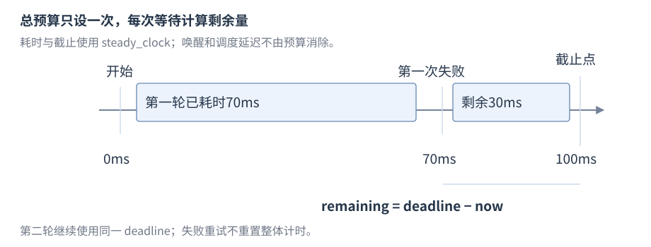

# 时间库

时间库用 `duration` 表示带单位的时间量，用 `time_point` 表示某时钟的时间点。**纪元**是某个时钟计时的零点；**单调性**表示随着现实时间向前，时钟读数不会倒退。时钟决定采用的零点及是否保证单调；C++20 的日历及时间区扩展把时间点映射成日期和当地时间。

基线：C++17 `<chrono>`；日历/时区为 C++20，需要提供对应设施的标准库。先查时间量、时间点、时钟及转换，再查日历与时间区。流与文件见 [R34](R34-streams-files.zh-CN.md)，文件系统见 [R35](R35-filesystem.zh-CN.md)。

## std::chrono::duration

**时间量**是次数与刻度单位的组合。公开声明摘要省略成员与约束：


```cpp
namespace std::chrono {
    template<class Rep, class Period = ratio<1>> class duration;
}
```

`Rep` 是计数表示类型，`Period` 是以秒为基准的刻度。**`std::ratio<N,D>`** 表示编译期有理数 N/D，例如 `ratio<1,1000>` 在 duration 中表示每刻度为千分之一秒；这里的比例保存在类型中，不是运行期除法。别名 `hours/minutes/seconds/milliseconds/microseconds/nanoseconds` 提供常用单位。类型的刻度不保证实际取时精度。

### duration 的构造与算术


在源文件开头加入 `#include <chrono>`，分别取得时间量、时间点和时钟的声明。

下面把毫秒与秒相加，查询共同单位中的计数。

```cpp
std::chrono::milliseconds timeout{1500};
std::chrono::seconds second{1};
auto total = timeout + second;              // 2500ms，相容单位取共同类型
auto ticks = total.count();                 // 2500，count 本身不携带单位
bool positive = total > decltype(total)::zero();
```

用 Rep 构造需要类型转换满足条件，跨 duration 的隐式转换只在不会因相应条件损失精度等情况下参与；整数毫秒不能隐式转换为整数秒。`zero/min/max` 给出对应表示界限，算术仍可能溢出，不能把单位类型当自动范围保护。

## std::chrono::time_point

公开声明摘要为 `template<class Clock,class Duration = typename Clock::duration> class time_point;`，位于 `std::chrono`，省略成员。`Clock` 标识时钟，`Duration` 表示自该时钟纪元起的时间量。


下面从稳态时钟的零点出发，增加 100 毫秒后计算差值。

```cpp
using Clock = std::chrono::steady_clock;
Clock::time_point start{};                  // 该时钟纪元，不是当前时间
Clock::time_point later = start + std::chrono::milliseconds{100};
auto elapsed = later - start;              // duration，等于 100ms
bool before = start < later;               // true
```

默认构造在纪元；`time_since_epoch()` 返回 Duration，`min/max` 给出可表示时间点。点加减时间量得到点，同一 Clock 的点相减得到时间量；不同 Clock 不可直接相减。系统时钟和稳态时钟的 count 不共享通用纪元。

## std::chrono::steady_clock

**稳态时钟**保证单调，适合耗时和截止点，不定义可移植日历纪元。公开形状省略具体成员类型：类提供 `rep/period/duration/time_point`，`static constexpr bool is_steady = true;`，以及 `static time_point now() noexcept;`。


下面在工作前后各取一次读数，差值保留时钟提供的单位。

```cpp
const auto start = std::chrono::steady_clock::now();
// 执行待计量的工作
const auto elapsed = std::chrono::steady_clock::now() - start;
// elapsed 保留时钟原有的 duration 单位
```

`elapsed` 是两个时间点之间的时间量，结果随工作和环境变化。需要取微秒计数时，先按后面的 `duration_cast` 规则转换单位，再调用 `count()`，输出时仍须标明单位。单调不承诺调度精度、每次调用成本或相邻取时结果一定不同。

## std::chrono::system_clock

**系统时钟**表示现实世界时间，可能被校时而不单调。类提供计时成员类型、`now()`、`to_time_t(const time_point&) noexcept` 和 `from_time_t(time_t) noexcept`；声明摘要省略具体类型。


在源文件开头加入 `#include <ctime>`，分别取得time_t 类型的声明。

下面将当前系统时间点转换为 time_t，再恢复为系统时间点。

```cpp
auto now = std::chrono::system_clock::now();
std::time_t external = std::chrono::system_clock::to_time_t(now);
auto restored = std::chrono::system_clock::from_time_t(external);
```

转换可能因 time_t 精度损失，不能要求 restored 与原值完全相等。C++17 不从实现常见纪元推出全部平台相同；C++20 为 system_clock 建立 Unix time 对应规定。日志时间戳与相对耗时分别使用适用时钟。

## std::chrono::high_resolution_clock

**高分辨率时钟**提供较短 tick 周期，可以是 `system_clock`、`steady_clock` 的别名或独立时钟。它提供相同 `Clock` 接口；不单凭名称保证单调或适合测量。


下面查询该实现是否保证单调，并取得一个读数。

```cpp
constexpr bool monotonic = std::chrono::high_resolution_clock::is_steady;
auto point = std::chrono::high_resolution_clock::now();
```

需要单调耗时直接选择 steady_clock；tick 周期与实际准确度不是同一个指标。

## duration_cast、time_point_cast 与舍入

**`duration_cast<To>(d)`** 把时间量转换为指定 duration 类型；**`time_point_cast<To>(t)`** 把时间点的精度转换为指定 duration，保留所属 Clock。`<chrono>` 的常用签名摘要省略约束：


```cpp
namespace std::chrono {
    template<class To, class Rep, class Period>
        constexpr To duration_cast(const duration<Rep, Period>& d);
    template<class To, class Clock, class Duration>
        constexpr time_point<Clock, To>
        time_point_cast(const time_point<Clock, Duration>& t);
}
```


下面把 1500 毫秒转成整数秒，对比四种舍入结果。

```cpp
std::chrono::milliseconds value{1500};
auto truncated = std::chrono::duration_cast<std::chrono::seconds>(value); // 1s
auto down = std::chrono::floor<std::chrono::seconds>(value);              // 1s
auto up = std::chrono::ceil<std::chrono::seconds>(value);                 // 2s
auto nearest = std::chrono::round<std::chrono::seconds>(value);           // 2s
```

例中 1500 毫秒得到截断结果 1 秒、向下结果 1 秒、向上结果 2 秒、最近结果 2 秒。若继续使用稳态时钟例中的 `elapsed`，`duration_cast<microseconds>(elapsed).count()` 才是微秒计数。duration_cast 向整数单位转换向零截断；C++17 floor/ceil 向下/上舍入，round 取最近、中点取偶数。time_point_cast 只调整精度，保留 Clock。转换不能消除 Rep 溢出；浮点转整数的 NaN、无穷和不可表示输入越出有效条件，外部超时先验证。

## 时间字面量

`std::chrono_literals` 的 `h/min/s/ms/us/ns` 后缀生成 `duration`，整数与浮点字面量可具有不同 `Rep`。


下面用带单位的后缀建立预算与间隔，再计算一次截止点。

```cpp
using namespace std::chrono_literals;
auto budget = 100ms;
auto interval = 1.5s;
auto deadline = std::chrono::steady_clock::now() + budget;
```

命名空间导入在需要的局部范围内进行。表达式保留单位，传递到接口时尽量不提前取 count。

## 绝对截止点

总预算可以通过一次计算的稳态 `deadline` 表示，重试复用同一点。每轮重新从 `now` 加完整预算会延长总等待。


下面先建立共同截止点，再根据当前时刻计算剩余预算。

```cpp
using Clock = std::chrono::steady_clock;
auto deadline = Clock::now() + std::chrono::milliseconds{100};
auto now = Clock::now();
if (now < deadline) {
    auto remaining = deadline - now;         // 下次等待使用剩余预算
}
```



图：100ms 总预算在第一次失败耗去 70ms 后只剩 30ms。调度与唤醒有延迟，时间点不保证任务恰好在此刻停止。

等待、取消请求和确认退出分别由并发/网络接口规定，见 R20、R21、R29；time_point 只负责表达时间。跨进程/机器不能传本机 steady_clock 原始 count 作为通用截止时间，须有相对预算或协议时钟约定。

## 日历类型与 std::chrono::year_month_day

**日历组件** `year/month/day` 表示年、月、日；**`year_month_day`** 表示年月日组合，可由组件或 `sys_days` 构造。公开声明摘要为 `class year_month_day;`，位于 `std::chrono`。


下面建立 2024 年 2 月 29 日，确认有效后转换为按天时间点。

```cpp
// C++20
using namespace std::chrono;
year_month_day date{year{2024}, month{2}, day{29}};
bool valid = date.ok();                     // true
sys_days point{date};                       // 按天精度的系统时间点
weekday day_of_week{point};
```

组件可表示不成立日期，转换前检查 `ok()`。加月份/年份可能得到不存在日期，需要明确月末裁剪或拒绝策略；不等同于固定秒数加法。`year_month_day_last` 表示某月最后一天，`hh_mm_ss<Duration>` 拆分时分秒，均作相关入口。

## std::chrono::zoned_time 与时间区

**时间区**把绝对时间点映射为当地时间。公开声明摘要为 `template<class Duration,class TimeZonePtr = const time_zone*> class zoned_time;`，位于 `std::chrono`，省略成员与约束；`Duration` 为存储精度，`TimeZonePtr` 指定时间区句柄。


下面按上海时间区建立当地时间描述，分别取得绝对点与当地读数。

```cpp
// C++20；需要实现提供时区数据库
using namespace std::chrono;
const time_zone* zone = locate_zone("Asia/Shanghai");
zoned_time<seconds> local{zone, floor<seconds>(system_clock::now())};
auto absolute = local.get_sys_time();
auto wall = local.get_local_time();
```

`get_time_zone/get_sys_time/get_local_time` 取得区、绝对点和当地点。locate_zone 可能因数据库/名称失败；当地时间在夏令时切换可不存在或重复，从当地点构造时需用 choose 等明确歧义策略。时区库可用性与数据库来源依实现，语言版本开关不证明设施齐全。

## 组合应用与参考资料

[原配套源码](../examples/r19-time-files.cpp) 的固定时间点计算演示重试剩余预算，同时包含现已归 R34/R35 的流和路径操作，供组合应用参考。
