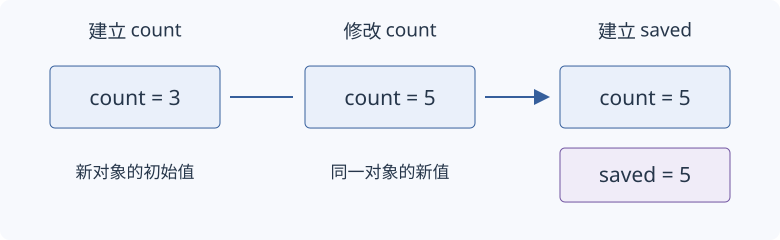

# 初始化与类型推导

变量需要一个初始状态，程序才能在这个状态上继续计算。本节从整数变量开始，先区分建立对象与修改对象，再比较初始化写法，最后解释自动推导类型时的复制与引用关系。

适用范围：C++17。阅读前需要认识 `int`、`double`、变量声明、普通赋值和函数体。下面的局部声明与操作放在函数体内；各个例子分别理解，只有文字明确指出时才沿用前文对象。

## 初始化与赋值

**初始化**（initialization）为新对象建立初始状态；**赋值**（assignment）改变已经存在的对象。两者可能都出现 `=`，要看它所在的位置。

```cpp
int count = 3;
count = 5;
int saved = count;
```

第一行声明并定义 `count`，用 `3` 初始化它。第二行没有声明新对象，只把已有的 `count` 改为 `5`。第三行建立另一个对象 `saved`，初始值来自此刻的 `count`，因此是 `5`。以后修改 `count`，不会同时修改这个整数副本。



图：先建立 `count`，再修改它，最后建立 `saved`。箭头表示执行顺序；方框表示两个独立的整数对象。

## 整数变量的常用写法

下面四个变量都得到初值 `3`：

```cpp
int equal = 3;
int round(3);
int brace{3};
int equal_brace = {3};
```

这些写法在本例中产生相同的值，但初始化过程的名称不同。先把具体写法与名称对应起来：

| 写法 | 名称 | 本例结果 |
| --- | --- | --- |
| `int equal = 3;` | 拷贝初始化 | 建立值为 3 的 int |
| `int round(3);` | 直接初始化 | 建立值为 3 的 int |
| `int brace{3};` | 直接列表初始化 | 建立值为 3 的 int |
| `int equal_brace = {3};` | 拷贝列表初始化 | 建立值为 3 的 int |

这里的“拷贝初始化”是初始化形式的名称，不表示一定先建立一个额外对象再复制。涉及类时，不同形式还会影响构造函数选择；[构造函数与析构函数](02-lifetime-raii.zh-CN.md#构造函数与析构函数)会先介绍构造函数，再用[直接构造与隐式转换](02-lifetime-raii.zh-CN.md#直接构造与隐式转换)说明这种差异。

## 没有显式初值的局部整数

函数体内的普通 `int` 局部变量如果只写名字，没有初始化器，就没有可以安全读取的确定初值。空花括号则会使这个整数得到零值。

```cpp
int pending;             // 此时不读取
pending = 7;             // 先写入确定的值
int observed = pending;  // 7
int zero{};              // 0
```

`pending` 的声明属于默认初始化；对于这里的自动局部整数，它不完成初值设置。`zero` 使用空列表，按相应规则进行值初始化，最终得到 `0`。这是针对本例整数的结论，不能据此认为所有类对象写 `{}` 都会把成员清零。

是否局部、是否具有静态存储期也会影响规则。本节先掌握普通局部整数；静态对象与类对象的完整规则在具备相应基础后分别展开。

## 花括号与窄化转换

把一种数值类型转换成另一种类型，有时会丢失信息。例如 `2.5` 是 `double` 值，把它转成整数就无法保留小数部分。**窄化转换**（narrowing conversion）是列表初始化按标准规定拒绝的一组转换。

```cpp
double measurement = 2.5;
int exact{12};
// int rejected{measurement}; // 浮点到整数，列表初始化拒绝
```

`exact` 的初值是可表示的整数常量，合法。注释中的声明把浮点数作为整数的列表初值，属于窄化，不能采用。这里先理解这一种清楚的差异；整数范围、浮点精度以及常量表达式豁免的完整条件需要分别检查。

花括号不是运行时范围检查工具。对于外部输入，仍需先确定允许的范围，再选择检查和转换方法。

## auto 与初值类型

**`auto`** 用初值推导声明中的类型。最简单的形式是 `auto 名字 = 初值;`，适合初值已经清楚表达类型的场合。

```cpp
auto count = 3;       // int
auto ratio = 2.5;     // double
auto saved = count;  // int，自己的整数副本
count = 9;
```

`saved` 的类型是 `int`，值仍是 `3`；它不会因为 `count` 变为 `9` 而跟着变化。类型在声明时确定，后续赋值不会让 `count` 变成另一种类型。只写 `auto count;` 没有初值，无法完成这种推导。

## const 与只读访问

**`const`** 在这里声明一个不能通过该名字修改的对象。它可以与显式类型或 `auto` 一起使用。

```cpp
const int limit = 10;
auto copied_limit = limit;       // int
const auto fixed_limit = limit; // const int
copied_limit = 12;
// fixed_limit = 12;            // 不能通过此名字修改
```

按值 `auto` 在这个例子中没有保留初值对象的顶层 `const`，因此 `copied_limit` 是可修改的副本。显式写 `const auto`，则使新对象也成为只读对象。初值来自只读对象，不等于新副本必须只读。

## 引用与按值推导

有时我们希望另一个名字访问同一个对象。**引用**（reference）为已有对象提供别名；本例的 `int&` 绑定一个可修改的整数对象。

```cpp
int source = 4;
int& alias = source;
alias = 7;
int copy = source;
source = 9;
```

给 `alias` 赋值实际修改 `source`，所以第三行后 `source` 是 `7`。`copy` 则是独立对象，最后仍为 `7`。引用绑定后不会因赋值改绑到另一个对象；使用这个引用时，被引用的对象必须仍然存在。

把同一关系写进类型推导：

```cpp
int source = 4;
auto copy = source;      // int，独立副本
auto& alias = source;   // int&，访问 source
const auto& view = source; // const int&，通过它只读
alias = 8;
```

最后 `source` 为 `8`，`copy` 仍为 `4`，通过 `view` 读到 `8`。`view` 的只读访问不会冻结原对象；这里仍可通过 `alias` 修改它。对只读整数初值，`auto&` 会推导为只读引用，不能借它绕过 `const`。

## decltype 与已有声明

**`decltype`** 查询表达式的类型，不执行被查询的表达式。先看未加额外括号的变量名：它取得该变量的声明类型。

```cpp
const int source = 4;
decltype(source) copied = 7; // const int
```

`copied` 是自己的只读整数对象，初值为 `7`。这与上一节的按值 `auto` 不同：`decltype(source)` 保留了 `source` 声明中的 `const`。

对括起来的名字，规则改为按表达式的值类别判断。这里的名字表达式标识已有对象，属于**左值**（lvalue），相应查询结果是引用类型：

```cpp
int source = 4;
decltype((source)) alias = source; // int&
alias = 6;                        // source 为 6
```

因此，额外括号在 `decltype` 中可能改变类型结果。完整的值类别规则还包括计算结果和允许复用资源的表达式，适合在引用与移动的基础之后展开；当前只需能解释这两个例子。

## 理解检查与后续规则

分别判断：`int n = 3; n = 5;` 哪一步建立对象？`auto copy = n;` 和 `auto& alias = n;` 哪个会跟随对 `n` 的修改？`decltype(n)` 与 `decltype((n))` 在这里分别是什么类型？

第一句建立并初始化 `n`，第二句赋值。`copy` 保存独立整数值，`alias` 访问同一个 `n`。若 `n` 声明为 `int`，两种查询分别得到 `int` 和 `int&`。

接下来可以进入分支、循环和普通函数。类的初始化放到构造函数之后；`auto&&`、转发引用和完整的 `decltype(auto)` 返回规则放到引用、值类别与模板之后；常量求值和静态初始化各自单独展开。这些后续规则都有用途，但不影响用本节的基础写法建立和修改整数对象。
