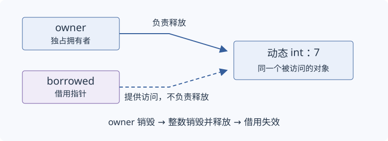

# 对象生命周期与 RAII

一个名字还在代码里，不代表它指向的对象仍然存在。本节沿着局部对象的建立、使用与销毁，解释引用的有效时间，再把对象的自动清理用于管理动态资源。

适用范围：C++17。阅读前需要掌握初始化、赋值、按值 `auto`、引用、指针的取址与解引用、普通函数和花括号形成的局部作用域。初始化、`auto` 和引用的入口见[上一组样稿](01-initialization-deduction.zh-CN.md)。类型定义可放在命名空间作用域，局部使用语句放在函数体内；各例分别理解。

## 作用域与对象生命周期

**作用域**规定一个名字在哪里可见；**生命周期**规定一个对象何时存在，并可以按对象规则使用。先观察普通局部整数：

```cpp
int total = 0;
{
    int item = 7;
    total += item;
}
int answer = total; // 7
```

`item` 在内层块中建立并初始化。离开这个块后，它的生命周期已经结束，名字也不再可见。`total` 属于外层块，仍可使用。这是普通自动局部对象的基本关系，不能把它直接推广到函数中的静态对象或动态创建的对象。

## 指针与借用有效时间

**借用**是通过指针或引用访问由别处负责维持生命周期的对象。保存地址不会延长目标的生命周期。

```cpp
int* borrowed = nullptr;
{
    int item = 7;
    borrowed = &item;
    int observed = *borrowed; // 7
}
// 此处不再通过 borrowed 访问 item
borrowed = nullptr;
```

内层块中 `item` 活着，`borrowed` 的解引用合法。离开块后，外层指针对象 `borrowed` 仍存在，但它原先指向的 `item` 已不存在。这种已经不能用于访问原对象的借用称为**悬垂借用**。把指针重新设为空，是改变指针自身的状态，并不是销毁或复活 `item`。

## 类、数据成员与成员访问

**类**把数据与相关操作组成一个类型。先用 `struct` 保存一个简单记录；这里的成员默认公开，可以通过点号访问。

```cpp
struct Record {
    int value;
};
// 函数体内：
Record record{7};
int observed = record.value; // 7
record.value = 9;
```

`record` 是一个 `Record` 对象，`value` 是它的数据成员。与整数变量一样，这个对象需要初始化，然后才能使用；花括号在这个简单记录中依次初始化成员。

## 构造函数与析构函数

**构造函数**（constructor）在建立类对象时初始化它的状态，名字与类名相同，没有返回类型。**析构函数**（destructor）在类对象销毁时执行清理，名字为 `~类名`，没有参数和返回类型。

```cpp
struct Record {
    int value;
    Record(int initial) : value(initial) {}
    ~Record() {}
};
// 函数体内：
{
    Record record(7);
    int observed = record.value; // 7
} // 调用析构函数
```

冒号后的 `value(initial)` 是成员初始化，先于构造函数体执行。本例构造函数体为空，成员已经得到初值 `7`。普通自动对象离开作用域时自动析构，不需要另写一条析构调用。

这里的空析构函数用于展示调用位置。实际没有额外清理工作的记录通常可以使用编译器提供的析构规则；构造和析构不意味着每个类都必须手写这两个函数。

## 直接构造与隐式转换

一个带单个参数的构造函数也可能参与隐式转换。**`explicit`** 在本例中禁止把一个整数隐式转换成 `Count`，但允许明确地直接构造它。

```cpp
struct Count {
    int value;
    explicit Count(int n) : value(n) {}
};
// 函数体内：
Count direct(3);
Count listed{3};
// Count implicit = 3; // 非法：不能这样隐式转换
```

前两行使用构造函数建立对象，成员值都是 `3`。注释中的拷贝初始化要求这里不允许的隐式转换。现在已经认识构造函数，才有条件理解为什么整数初始化中看起来相近的标点，在类对象上可能带来不同结果。

## 析构与自动清理

为了看清对象退出作用域时发生什么，下面用一个计数器记录当前活着的对象数量。计数器只是观察状态，本例只在原位置建立、使用并销毁对象，不涉及复制它。

```cpp
struct Active {
    int& count;
    Active(int& value) : count(value) { ++count; }
    ~Active() { --count; }
};
// 函数体内：
int count = 0;
{
    Active active(count); // count 为 1
}                        // count 恢复为 0
```

构造时，成员引用绑定外层计数器并增加计数；析构时减少计数。外层 `count` 比 `active` 活得久，所以这次引用访问有效。如果离开作用域时需要的动作是释放内存、解锁或关闭句柄，也可以让管理对象的析构承担这项责任。

**RAII**（Resource Acquisition Is Initialization，资源获取即初始化）把资源的取得与管理对象的初始化连接起来，并在管理对象销毁时释放资源。**所有权**规定谁承担释放责任，以及责任怎样转交。要让自动清理可靠，资源一经取得就应交给适当的管理对象。

## 动态对象与释放责任

动态对象的生命周期不一定随创建它的局部块结束。先认识取得和释放动作，无需头文件：

```cpp
int* pointer = new int(7);
int observed = *pointer; // 7
delete pointer;
pointer = nullptr;
```

`new int(7)` 取得存储并建立初值为 `7` 的整数对象，返回它的地址。`delete` 销毁适用的对象并释放存储；随后不能再访问原对象。这里的 `pointer` 是局部指针对象，动态整数是另一个对象。只让 `pointer` 离开作用域，不会自动执行 `delete`。

本例是单个对象，数组另有配对规则。手工释放还容易被提前返回或异常跳过，因此常用代码应把释放责任交给资源拥有者。

## unique_ptr 的建立与借用

**`std::unique_ptr`** 是独占拥有者：同一项所管理资源的释放责任由一个这样的拥有者承担。使用前在源文件开头加入 `#include <memory>`。`std::unique_ptr<int>` 中的 `<int>` 指出所管理的对象类型，当前无需先学习如何编写模板。

**`std::make_unique<int>(7)`** 建立整数对象并返回管理它的独占拥有者。这个工厂自 C++14 提供，本样稿按 C++17 阅读。

```cpp
auto owner = std::make_unique<int>(7);
int* borrowed = owner.get();
int observed = *borrowed; // 7
```

`owner` 的类型是 `std::unique_ptr<int>`。`get()` 提供用于访问的裸指针，没有转交释放责任；不能对这个借用指针独立执行 `delete`。在本例没有转交或重置拥有者的情况下，动态整数一直活到 `owner` 销毁，由它自动释放。



图：拥有者负责动态整数的释放，借用指针只提供访问。拥有者对象仍在，与它是否仍持有这个整数，是两个不同问题。

## 所有权转交与 std::move

需要把独占责任交给另一个对象时，使用移动构造。**移动构造**建立新的目标对象，并按类型规则接收源状态。对于这里的 `unique_ptr`，接收的是管理同一个动态整数的责任；它不复制这个整数。

`std::move` 的声明来自 `<utility>`，在文件开头再加入 `#include <utility>`。下面先让 `source` 管理整数，再把责任交给 `target`，观察原有借用是否还能访问这个整数：

```cpp
auto source = std::make_unique<int>(7);
int* borrowed = source.get();
auto target = std::move(source);
int observed = *borrowed; // 7，整数仍由 target 保活
```

`std::move` 使后续操作可以把 `source` 当作允许接收其资源的源；调用 `move` 本身不搬迁或释放对象。资源转交发生在 `target` 的构造中。这里 `source` 仍存在但为空，`target` 接管原整数，整数的地址没有因为这次转交而改变。

不能再通过空的 `source` 解引用。也不能由这个例子推断所有类型移动后都为空；那是需要按具体类型判断的契约。

本例的借用继续有效，是因为移动只转交同一个动态整数的所有权，目标又继续保活它。其他类型移动后，已有指针和引用是否有效，仍要按该类型和操作的规则判断。

## 异常退出与清理

失败也可能使执行离开作用域。**异常**把失败从发生位置传向适用的处理器；`try` 包围可能失败的操作，`throw` 发起异常，`catch` 接收匹配类型的异常。

这里用 `std::runtime_error` 表示一次失败，它的声明来自 `<stdexcept>`，在文件开头加入 `#include <stdexcept>`。沿用前面的 `Active` 定义，观察异常传向处理器时计数怎样变化：

```cpp
int count = 0;
try {
    Active active(count); // count 为 1
    throw std::runtime_error("failure");
} catch (const std::runtime_error&) {
    // 进入这里时 active 已销毁，count 为 0
}
```

寻找匹配处理器并退出相关作用域时，已经完成构造的自动对象被销毁，这个过程称为**栈展开**（stack unwinding）。因此，已经建立的 `unique_ptr` 在同类退出路径中也会清理自己的资源。

这项保证针对对象清理，不自动撤销写入文件或发送消息等外部效果。构造失败、异常安全等级和不抛清理还需在错误处理部分展开。

## 理解检查与后续规则

外层指针对象还存在时，内层局部整数是否一定还存在？`owner.get()` 是否转交释放责任？把 `unique_ptr` 移动给另一个拥有者后，动态整数是否被复制？

三者分别是：不一定，目标生命周期必须单独检查；没有转交；没有复制，本例转交的是同一整数的释放责任。正常和异常退出时，都要检查由哪个已经建立的拥有者负责清理。

共享所有权、数组删除器、手工存储重用和分配器适合在这条基础关系清楚之后学习。完整的移动规则需要值类别、重载和特殊成员函数，但理解本例的独占责任转交不要求先掌握所有转发规则。
